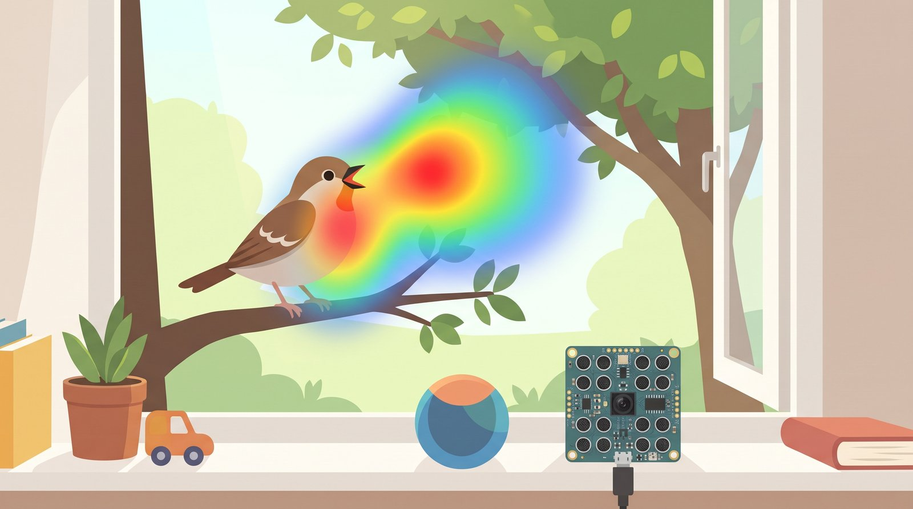
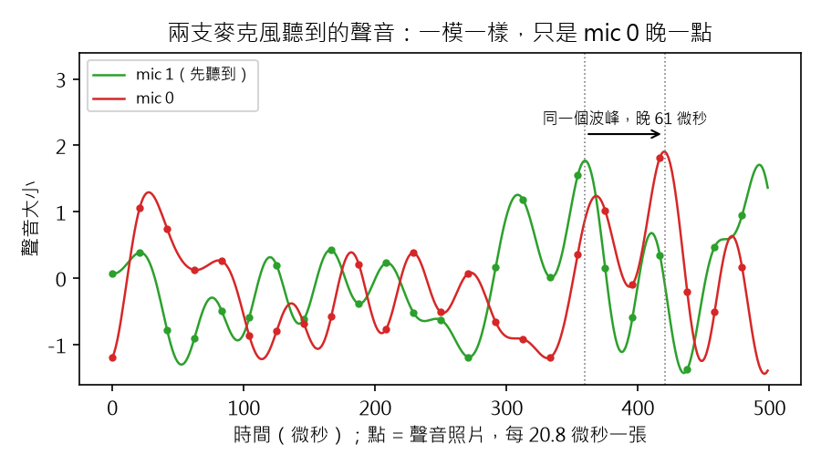
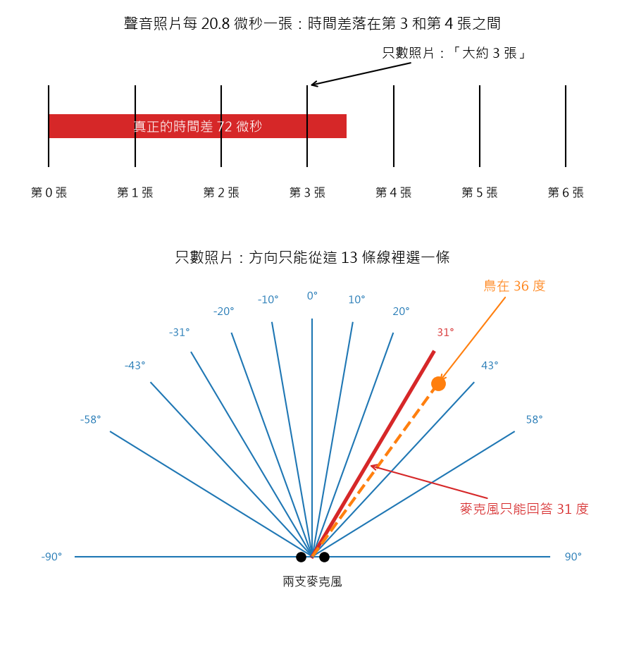
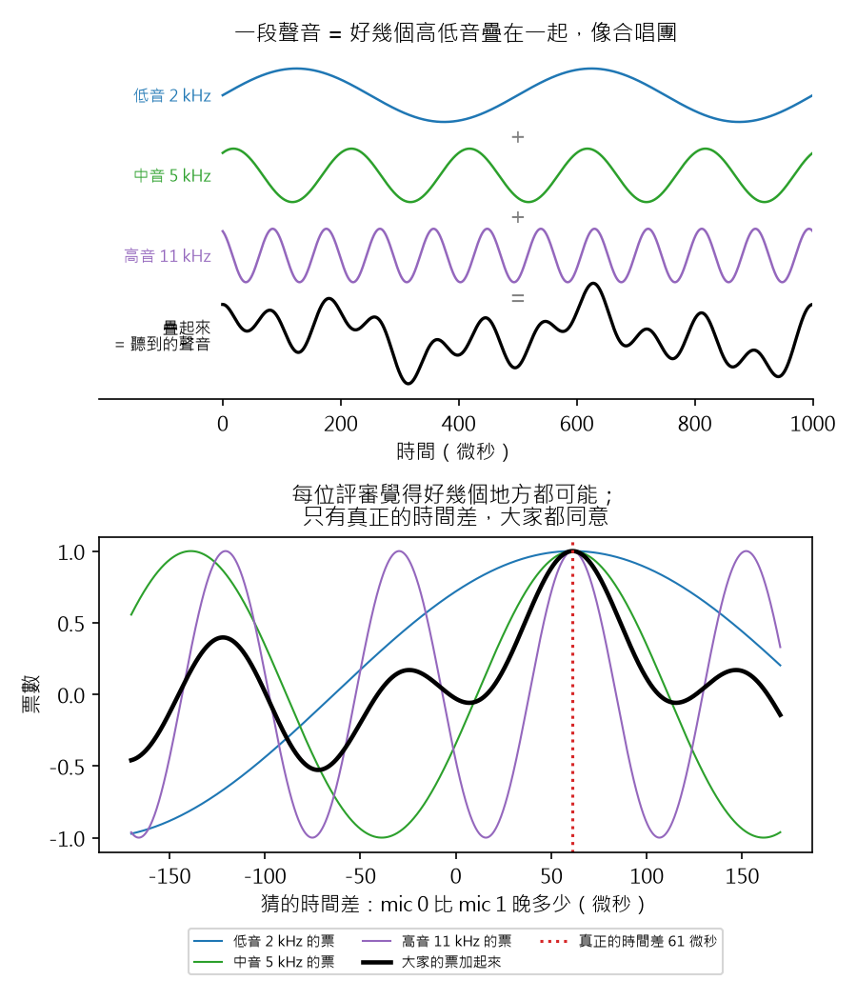
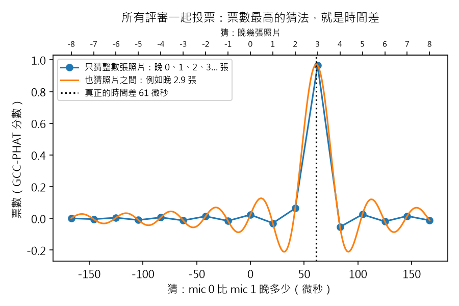

# 聲音相機 #1：兩支麥克風，怎麼聽出聲音從哪裡來？

> 草稿（Claude 起稿，Aaron 改寫後發布）。數字全部來自 `scripts/step1_two_mics.py`，
> 程式碼在 GitHub tag `step-1`。寫給 12 歲的讀者；「深入一點」可以跳過。

## 重點摘要：這篇會教你的 3 件事

1. **聲音的「先到、後到」就是方向。** 聲音會先碰到比較近的麥克風，晚一點才到另一支。
   晚了多少，就知道聲音從哪個方向來。
2. **聲音晚到的時間，比麥克風「拍照」的間隔還短，但用數學就能補上。**
   麥克風像一台連拍相機，每秒拍很多張「聲音照片」。聲音晚到的時間，比兩張照片之間還短。
   不用換更快的相機：用數學算出照片之間的聲音，就能量準。訣竅是只聽鳥叫，不管其他雜音。
3. **真正的敵人是雜訊。** 太吵的時候，答案不是慢慢變差，而是突然全錯，像掉下斷崖。
   雜訊大的話，多聽久一點，有可能真能判定出來。

窗外有鳥在叫，我想知道牠在哪一棵樹上。目標是做一台「聲音相機」：一組麥克風聽聲音，
把聲音的位置和大小畫成一張彩色的「熱力圖」，疊在即時影像上，像熱像儀一樣。

*示意圖：窗台上的板子有 16 支麥克風和一個鏡頭。熱力圖越紅的地方，就是聲音從那裡來。（AI 生成，Gemini）*

第一步先不買硬體，只在電腦裡模擬。問題縮到最小：**兩支麥克風，能不能聽出聲音的方向？**

## 1. 聲音先到一支、晚到另一支：時間差就是方向

你有兩隻耳朵。有人在你右邊拍手，右耳先聽到，左耳晚一點點才聽到。
這個「晚一點點」短到你感覺不到，但大腦會用它判斷聲音從哪裡來。閉上眼睛也知道。

兩支麥克風也一樣。想像聲音像海浪，一整排平平地推過來（這排浪頭叫「波前」）。
浪頭斜斜地來，就會先碰到一支麥克風，另一支要等浪頭再多走一小段路：

圖裡的紅線，就是浪頭多走的那段路。聲音越斜著來，紅線越長，晚到的時間就越多。
聲音從正前方來，兩支同時聽到，紅線長度是零。

所以反過來：**只要量出「晚了多少」，就能算出聲音從哪個角度來。**

> **深入一點：** 波前和麥克風連線的夾角也是 θ（圖中藍色）。紅線、波前和連線組成直角三角形，
> 斜邊是兩支麥克風的距離 d，所以紅線 = d × sin(θ)。除以聲速 c 就是時間差：
> 時間差 τ = d × sin(θ) / c，反過來 θ = arcsin(c × τ / d)。

## 2. 時間差太短，麥克風量得很粗：像一把只有公分刻度的尺

麥克風聽聲音的方式，很像相機「連拍」：它每秒拍 48,000 張「聲音照片」，
每張照片記下那一瞬間的聲音大小。這一張張照片，叫做「取樣點」。

48,000 張聽起來很多，但聲音跑得更快。我的兩支麥克風只隔 4.2 公分（大約一個大拇指長）：

- 兩張照片之間隔 20.8 微秒（1 微秒是一百萬分之一秒）。
- 聲音從 30 度來，兩支麥克風只差 61 微秒，不到 3 張照片。
- 就算聲音從正側面來，最多也只差大約 6 張照片。

這是兩支麥克風真正聽到的聲音。點是聲音照片，線是照片背後真正的聲音。
紅線和綠線長得一樣，只是紅線晚了 61 微秒。注意那個最高的波峰：它剛好落在兩張照片之間，
沒有一張照片剛好拍到它。

如果只能猜「晚了整數張照片」，就像用一把**只有公分刻度、沒有毫米刻度的尺**量東西。
能量出來的角度只有 13 種，正前方附近一格就跳大約 10 度。要找鳥，這太粗了。

- **上圖：** 鳥在 36 度時，真正的時間差是 72 微秒，落在第 3 和第 4 張照片之間。
  只猜整數張照片的話，只能說「大約晚 3 張」，剩下那一小段就量不到了。
- **下圖：** 因為只能數整張照片，麥克風能回答的方向只有這 13 條線。
  鳥明明在 36 度（橘色），麥克風只能挑最近的一條線，回答 31 度，差了 5 度。

> **深入一點：** 聲速 343 m/s、取樣率 48 kHz。最大時間差 122.4 微秒 = 5.88 個取樣點；
> 30 度時 61.2 微秒 = 2.94 個取樣點。

## 3. 怎麼找出時間差：讓每個頻率當評審，一起投票（GCC-PHAT）

**第一個想法：描圖紙。** 把兩支麥克風的聲音各畫在一張描圖紙上，疊起來，
左右慢慢滑動。滑到兩條線對得最整齊的時候，滑了多少，就是時間差。

**更好的方法：請評審投票。** 一段聲音其實是很多種高低音（頻率）疊在一起，像合唱團：

- **上圖：** 低音、中音、高音三條線疊起來，就是麥克風聽到的那一條歪歪扭扭的聲音。
- **下圖：** 這個方法叫 GCC-PHAT，它讓每一個高低音都當一位評審，各自投票說「我覺得時間差是多少」。
  每位評審都覺得好幾個地方可能（每條彩色線都有好幾個高點），因為它的波形一直重複。
  但只有在真正的時間差 61 微秒，所有評審的高點都對齊。把大家的票加起來（黑線），那裡最高。

最重要的規則是：**每位評審只有一票，嗓門大的也一樣。** 所以很吵的低音嗡嗡聲，
不會一個人蓋過大家。真正的聲音有成百上千位評審，票疊起來，就變成一根又高又尖的尖峰：

**注意：這張圖的點，和第 2 節波形圖的點意思不一樣。** 波形圖的點是「聲音照片」；
這張圖的每一個點，是一個「猜法」。

這張圖是投票結果。我們一直猜「mic 0 比 mic 1 晚多少」，每猜一次，就請所有評審計票一次。
橫軸是猜的答案，縱軸是這個猜法得到的票數。票數最高的猜法，就是答案。

- **藍點：只猜整數張照片。** 只猜「晚 0 張、1 張、2 張、3 張……」（圖上方的刻度）。
  真正的答案是晚 2.9 張（61 微秒），不是整數，所以沒有一個藍點剛好猜中。
  藍點最高的是「晚 3 張」（62.5 微秒），很接近，但差了一點。
- **橘線：也猜照片和照片之間。** 照片之間的聲音可以用數學算出來（像連連看，第 4 節會再說明），
  所以也能猜「晚 2.8 張」「晚 2.9 張」這種中間的答案。橘線的最高點，剛好落在真正的 61 微秒。

> **深入一點：** GCC-PHAT 全名 Generalized Cross-Correlation with Phase Transform
> （廣義互相關－相位轉換）。在頻域做互相關，再把每個頻率除以自己的大小，只留相位，
> 所以每個頻率的權重相同。橘線是在頻域補零 16 倍再反轉換，每 1.3 微秒一點。
> 尖峰兩旁的小波紋來自頻寬有限，不是聲音。

## 4. 角度誤差的兩個發現：也猜照片之間就準很多；越靠側面越不準

我讓聲音從左邊 85 度一路移到右邊 85 度，每移 1 度就量一次，看麥克風回答幾度：

- **上圖：麥克風回答的角度。** 藍色是一階一階的樓梯：只猜整數張照片，所以只有 13 種答案。
  橘色也猜照片之間，幾乎貼著正確答案（黑色虛線）。
- **下圖：答錯了幾度。** 灰色區域是左右 60 度以內。

**發現一：也猜照片之間，就準很多，不用買更快的相機。** 只猜整數張照片時，60 度以內最多答錯 8.3 度；
也猜照片之間，最多只錯 0.5 度。
為什麼照片之間也能猜？像「連連看」：聲音裡沒有快到相機跟不上的抖動，
所以點跟點之間只有一種平滑的連法，可以用數學算出來。

**發現二：越靠側面越不準。** 想像爬一座圓圓的山。在山腰走一步，高度變很多；
在山頂走一步，高度幾乎不變。時間差就像高度，角度就像你走的位置。
聲音在正前方時，像在山腰：角度變一點，時間差就變很多，很好分辨。
聲音在側面時，像在山頂：角度變很多，時間差卻幾乎不動，就很難分辨。

> **深入一點：** 角度誤差 = 時間差誤差 × c / (d × cos θ)。正前方 cos θ = 1；60 度時 cos θ = 0.5，
> 誤差變 2 倍；越接近 90 度，cos θ 越接近 0。也猜照片之間時，60 度以外最大誤差 4.3 度，
> 只猜整數張照片時最大 20 度。

## 5. 先挑對評審：只讓聽得到鳥叫的頻率投票

接著我把聲音換成「鳥叫」：一段從低音滑到高音的口哨聲，放在 30 度。結果反而變不準了：
三次測試，答案分別是 36.5 度、26.5 度、25.8 度。

問題出在評審。鳥叫只有中高音，其他頻率的評審**根本沒聽到鳥叫，只聽到雜訊**。
可是規則說每位評審都有一票，這些沒聽到的評審就亂投，把答案拉歪。

解決方法很簡單：**只請聽得到鳥叫的評審投票。** 這樣三次都答對：30.0 度。

這就像在吵鬧的派對裡找朋友：你會專心聽朋友說話的聲音，不會去管旁邊的音樂。
這會是之後「找鳥模式」的基礎。

> **深入一點：** 口哨聲是 2 到 6 kHz 的掃頻音，背景雜訊比它小 20 dB。
> 在 GCC-PHAT 裡只保留 2 到 6 kHz（`gcc_phat(..., band=(2000, 6000))`）。

## 6. 遠的聲音難找，是因為雜訊太大：太吵會突然失敗，聽久一點可以撐住

你可能會想：遠的鳥比較難找，所以要更快的相機。模擬的答案不一樣。

**距離本身不影響「方向」。** 鳥在 30 度，不管在 10 公尺還是 100 公尺，
聲音都是斜 30 度到達，兩支麥克風的時間差一樣。
但方向差一點點，遠的地方就偏很多，就像拿手電筒：手轉一點點，遠處牆上的光點就移很多。
差 0.5 度，在 10 公尺外大約偏 9 公分，在 50 公尺外大約偏 44 公分。

**真正的問題：遠的聲音比較小聲，雜訊卻一樣大。** 就像朋友在操場另一頭叫你，
旁邊同學的聊天聲卻就在耳邊。

**訊雜比**，就是「你要的聲音」和「雜訊」誰比較大聲。單位是 dB（分貝）。
0 dB 是一樣大聲；負數代表雜訊比較大聲。

**dB 是「乘法」的尺，不是「加法」的尺。** 它跟地震規模很像：規模 6 和規模 7 只差 1，
威力卻差了好幾十倍。dB 也是這樣，每少 10 dB，雜訊的力量就多 10 倍：

- 0 dB：雜訊和聲音一樣大。
- -10 dB：雜訊大 10 倍。
- -20 dB：雜訊大 100 倍。

所以 -10 dB 和 -20 dB 不是「差一點」，而是雜訊又多了 10 倍。

> **深入一點：** 功率比 dB = 10 × log10(功率比)；振幅比 dB = 20 × log10(振幅比)。
> +6 dB 是功率 4 倍、振幅 2 倍；+3 dB 是功率 2 倍。距離加倍，空曠處音量少 6 dB，功率剩 1/4。
> 用 dB 是因為聲音的強度範圍很大：從剛好聽得到到震耳欲聾，功率差大約一兆倍（120 dB）。

**來玩一個遊戲。** 你閉著眼睛，朋友在教室某個角落叫你的名字，你要指出他在哪裡。
教室很安靜時，你每次都指得對。同學開始聊天，越來越吵，你還能指對嗎？
朋友只叫一聲，和連續叫好幾聲，哪一種比較容易？

我讓電腦玩這個遊戲：

- 「朋友」是 30 度方向的聲音，「同學聊天」是雜訊。
- 每一種吵鬧程度，都玩 200 次。
- 答案和 30 度差不到 2 度，就算「指對」。200 次裡指對的比例，就是正確率。
- 朋友叫一次有兩種長度：0.1 秒，和長 4 倍的 0.4 秒。

**怎麼看這張圖：** 往右是安靜，往左是越來越吵。圖上方的「10x」是雜訊比聲音大 10 倍。
縱軸是正確率。

| 雜訊是聲音的幾倍 | 聽 0.1 秒，正確率 | 聽 0.4 秒，正確率 |
|---|---|---|
| 1 倍（一樣大） | 100% | 100% |
| 3 倍 | 100% | 100% |
| 10 倍 | 84% | 100% |
| 18 倍 | 50% | 92% |
| 32 倍 | 17% | 61% |

兩件事很重要：

- **太吵的時候，答案會突然全錯。** 雜訊大 10 倍時，正確率還有 84%；
  再吵一點，到 32 倍，只剩 17%，跟亂猜差不多。不是慢慢變差，而是像掉下斷崖。
  原因是：雜訊也會讓評審亂投票，造出假的「最高票」。雜訊夠大時，假的最高票比真的還高，
  答案就跳到隨便一個方向。
- **聽久一點，可以撐住。** 朋友連續叫好幾聲，每一聲都從同一個地方來；
  雜訊每一刻都不一樣。聽得越久，真的票越疊越高，亂投的票互相抵消。
  在雜訊大 18 倍時，聽 0.4 秒的正確率從 50% 升到 92%。
  但注意：聽 4 倍久，只能多忍受 2 倍的雜訊。這也是「乘法的尺」的結果。

**那換更快的相機（更高的取樣率）呢？幫助很小。** 因為照片之間的聲音本來就能用數學算出來（第 4 節）。

所以要找更遠的鳥，順序是：先聽久一點，再只請聽得到鳥叫的評審投票（第 5 節），
再用更多麥克風（下一篇），最後才考慮更快的相機。

> **深入一點：** 斷崖從 0.1 秒到 0.4 秒往左移大約 3 dB。取樣率的公平比較（2 到 8 kHz 的聲音，
> 每個頻率的雜訊一樣多）：0 dB 時 48 kHz 誤差 0.56 度、96 kHz 0.50 度；-5 dB 時 1.01 度對 0.96 度。

## 7. 兩支麥克風做不到的事

- **前後分不出來。** 聲音從前面 30 度來，和從後面 30 度來，就像照鏡子一樣，
  兩支麥克風聽到的時間差一模一樣。
- **只知道左右，不知道上下。** 兩支麥克風排成一條線，只能分辨左右。
  鳥在樹梢還是樹根，它分不出來。

所以下一篇：把 16 支麥克風排成 4×4 的方格，從「一個角度」變成「一整張聲音地圖」。
我也會用模擬比較兩種麥克風板，決定要買哪一塊。

## 程式碼

- GitHub：https://github.com/HsinNan123/acoustic-camera （tag `step-1`）
- 核心：`acam/delay.py`（GCC-PHAT、角度）、`acam/sim.py`（模擬兩支麥克風）
- 重現本文所有數字和圖：`python scripts/step1_two_mics.py`
