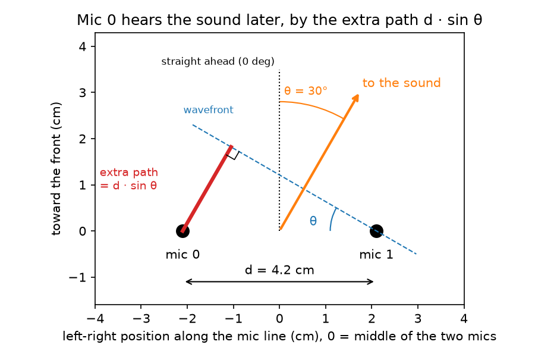
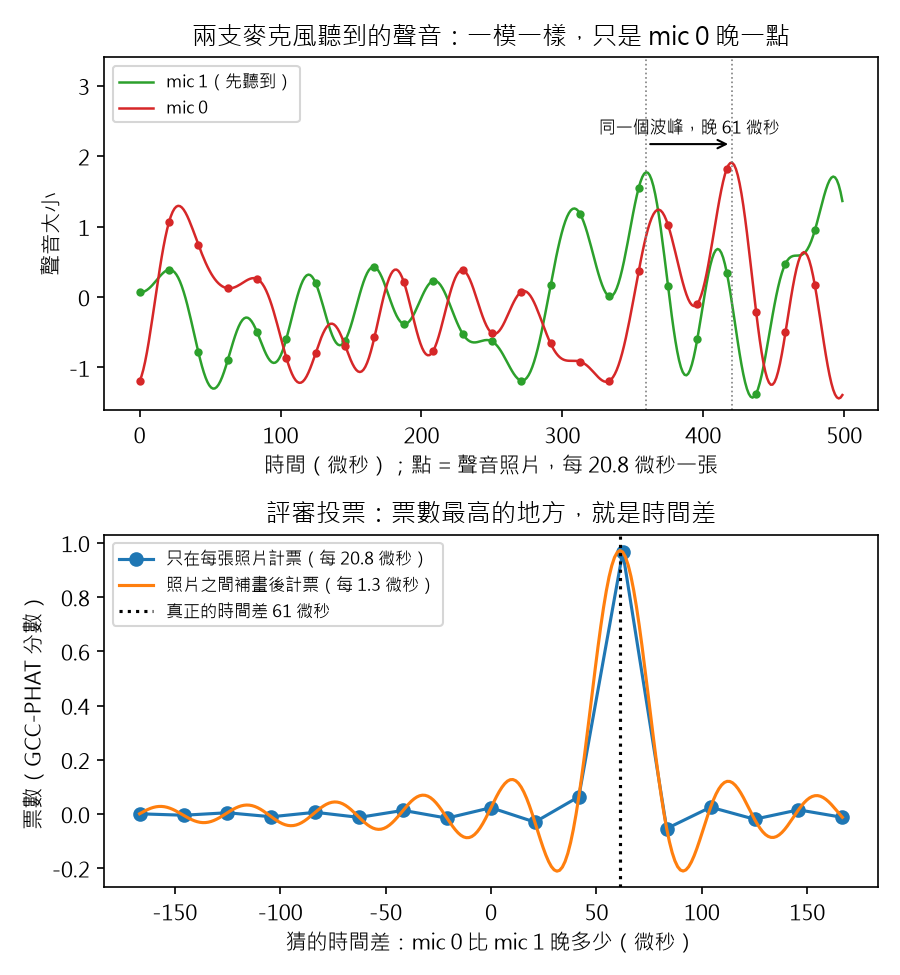
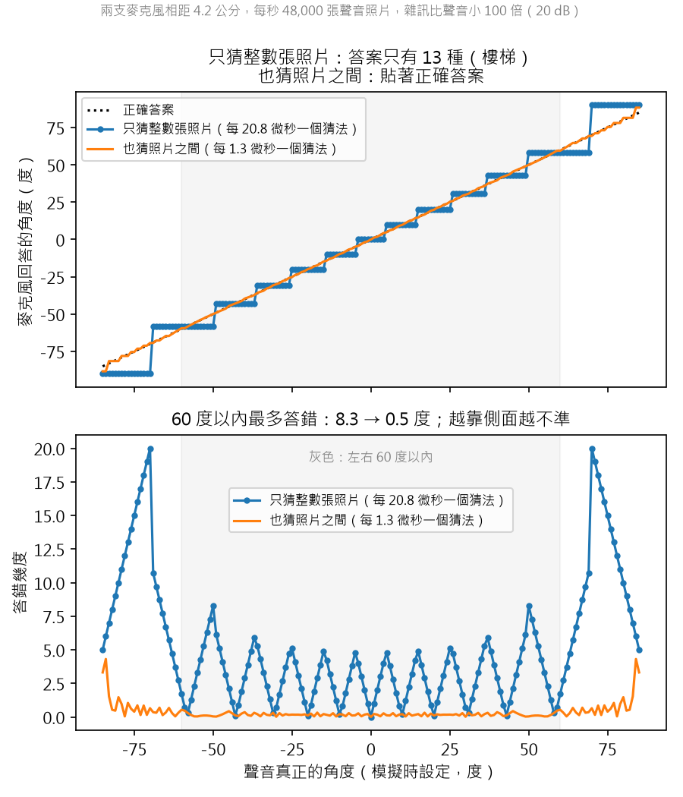
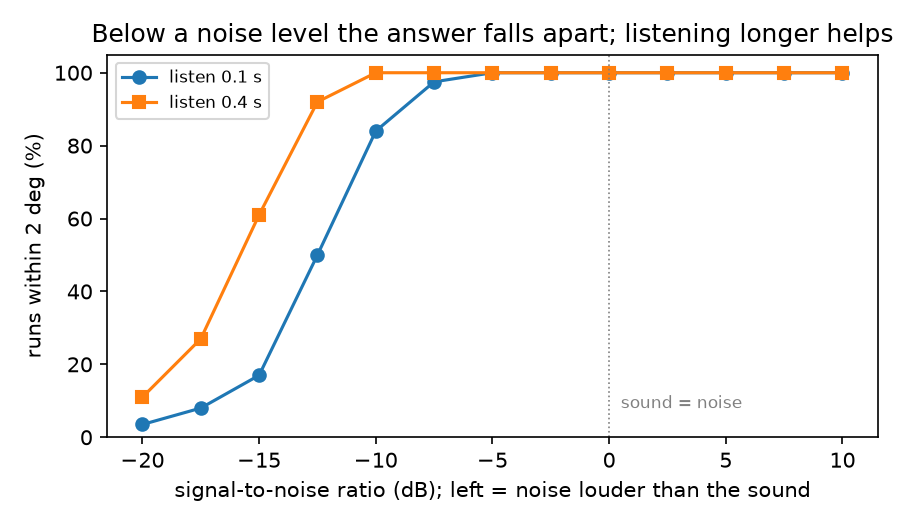

# 聲音相機 #1：兩支麥克風，怎麼聽出聲音從哪裡來？

> 草稿（Claude 起稿，Aaron 改寫後發布）。數字全部來自 `scripts/step1_two_mics.py`，
> 程式碼在 GitHub tag `step-1`。

## 重點摘要：這篇會教你的 7 件事

1. **原理：** 聲音先到一支麥克風，晚到另一支。時間差 = d × sin(θ) / c，量到時間差就能算出角度。
   兩支相距 4.2 cm，聲音從 30 度來，時間差只有 61 微秒。
2. **時間差比取樣點還小：** 48 kHz 時，時間差最多只有 5.9 個取樣點。只看取樣點，角度只有 13 種答案。
3. **GCC-PHAT 怎麼找時間差：** 每個頻率只留相位，權重相同，一起投票；票疊最高的地方就是時間差。
4. **角度誤差的兩個規則：** 取樣點之間可以用數學補細，不用更快的硬體（±60 度內誤差從 8.3 度降到 0.5 度）。
   越靠側面越不準，誤差隨 1/cos θ 變大。
5. **先限制頻段：** 只有雜訊的頻率也會投票，把答案拉歪。鳥叫在 30 度，用全部頻率得到 25.8 到 36.5 度；
   只聽 2 到 6 kHz，得到 30.0 度。
6. **遠的聲音難定位，是因為訊雜比低：** dB 是對數，不是線性。雜訊大到某個程度，正確率會像斷崖一樣掉下去
   （雜訊是聲音 10 倍時 84%，32 倍時 17%）。聽 4 倍久，正確率回到 61%。
7. **兩支麥克風的極限：** 分不出前後，也只有一個方向。所以下一步要用 16 支麥克風畫出一張聲音地圖。

窗外有鳥在叫，我想知道牠在哪一棵樹上。目標是做一台「聲音相機」：一組麥克風聽聲音，
把聲音的位置和音量畫成熱力圖，疊在即時影像上。

第一步先不買硬體，只用模擬。問題縮到最小：**兩支麥克風，能不能算出聲音的角度？**

## 1. 原理：聲音先到一支，晚到另一支

人有兩隻耳朵。聲音從右邊來，右耳先聽到，左耳晚一點點。大腦用這個時間差判斷方向。

兩支麥克風也一樣。聲音從遠處來，到達時是一道平的「波前」(wavefront)。
它先碰到靠近的那支，另一支要多走一段路：



為什麼是 sin？波前和兩支麥克風的連線，夾角也是 θ（圖中藍色）。
紅線、波前和連線組成一個直角三角形，斜邊是 d，所以紅線 = `d × sin(θ)`。
這就是 mic 0 多走的路。除以聲速，就是時間差：

```
時間差 τ = d × sin(θ) / c        →        θ = arcsin(c × τ / d)
```

只要量到 τ，就能算出角度 θ。

## 2. 時間差最多只有 5.9 個取樣點：只看取樣點，角度只有 13 種答案

我用的間距是 4.2 cm（之後可能買的 16 麥克風陣列 UMA-16 就是這個間距）。
聲速 343 m/s，取樣率 48 kHz：

| 情況 | 時間差 | 等於幾個取樣點 |
|---|---|---|
| 聲音從正側面來（最大） | 122.4 微秒 | 5.88 點 |
| 聲音從 30 度來 | 61.2 微秒 | 2.94 點 |

一個取樣點是 20.8 微秒。如果時間差只能是 0、1、2、3… 個取樣點（0、20.8、41.7、62.5… 微秒），
角度只有 13 種可能的答案。正前方附近，一格就跳大約 10 度。

## 3. 怎麼量時間差：GCC-PHAT

最直覺的方法是「互相關」(cross-correlation)：把一支麥克風的聲音左右滑動，
和另一支比對，對得最整齊的那個位移，就是時間差。

GCC-PHAT 是改良版，全名 Generalized Cross-Correlation with Phase Transform
（廣義互相關－相位轉換）。名字的兩半就是它的兩個動作：
「廣義互相關」是在頻率上做互相關；「相位轉換」是把每個頻率的強弱拿掉，只留相位。
這樣每個頻率都投一票，而且權重相同，不管那個頻率多大聲。只有在真正的時間差上，所有頻率的票才會疊在一起，形成一根尖峰。
低頻的嗡嗡聲再大聲，也不會蓋過其他頻率。



上圖是兩支麥克風實際收到的波形。點是真正的取樣點，每 20.8 微秒一個；
線是這些點背後的平滑波形。mic 0 收到的是同一個波形，只是晚了 61 微秒。
注意最高的那個波峰落在兩個取樣點之間：真正的時間差不是取樣點的整數倍。

下圖不是波形，是 GCC-PHAT 的分數：橫軸是「假設的時間差」，縱軸是這個假設有多對。
藍點只在取樣點上算分數（每 20.8 微秒一點），最高點落在 62.5 微秒，離真值 61 微秒差一點。
橘線是同一條分數曲線，補細 16 倍（在頻域補零，再做反轉換），每 1.3 微秒一點，
最高點就落在真值上。尖峰兩旁的小波紋來自頻寬有限，不是聲音。

## 4. 角度誤差的兩個規則：取樣點之間可以補細；越靠側面越不準（∝ 1/cos θ）

模擬一個噪音般的聲音（像樹葉沙沙聲），背景雜訊比聲音小 20 dB。
我把聲源從 -85 度移到 +85 度，每 1 度測一次。橫軸是模擬時設定的真實角度。



- **上圖：麥克風回報的角度。** 藍色是階梯：時間差只能是 0、1、2… 個取樣點，
  所以答案只有 13 種。真實角度在兩階之間時，答案卡在同一階。橘色補細後，幾乎貼著完美答案。
- **下圖：誤差 = 回報角度 − 真實角度。** 灰色區域是 ±60 度。

| 方法 | ±60 度內最大誤差 | 60 度以外 |
|---|---|---|
| 只看取樣點（每 20.8 微秒） | 8.3 度 | 最大 20 度 |
| 補細 16 倍 | 0.5 度 | 最大 4.3 度 |

兩件事可以看出來：

- **補細很重要。** 不用買更快的硬體，數學就能把誤差從 8.3 度降到 0.5 度。
- **側面最不準。** 正前方，角度一變，時間差變很多；靠近側面，角度變很多，
  時間差卻幾乎不動（sin 曲線在 90 度附近是平的）。所以同樣的量測誤差，在側面變成大的角度誤差。
  寫成公式：角度誤差 = 時間差誤差 × c / (d × cos θ)。正前方 cos θ = 1；
  到 60 度，cos θ = 0.5，誤差變 2 倍；越接近 90 度，cos θ 越接近 0，誤差越大。

## 5. 先限制頻段：GCC-PHAT 讓只有雜訊的頻率也一起投票

我把聲音換成一段 2 到 6 kHz 的「鳥叫」(頻率往上滑的哨音)，放在 30 度：

| 雜訊樣本 | 用全部頻率 | 只用 2–6 kHz |
|---|---|---|
| 1 | 36.5 度 | 30.0 度 |
| 2 | 26.5 度 | 30.0 度 |
| 3 | 25.8 度 | 30.0 度 |

原因正是 GCC-PHAT 的優點：每個頻率一票。鳥叫只佔 2–6 kHz，
其他頻率裡只有雜訊，但雜訊也一樣投一票，把尖峰拉歪。
只讓 2–6 kHz 投票，答案回到 30.0 度。

**教訓：先知道你要找的聲音在哪個頻段，只聽那一段。** 這會是第 5 步「找鳥模式」的基礎。

## 6. 遠的聲音難定位，是因為訊雜比低：低於門檻會突然失敗，聽久一點可以撐住

直覺會說：遠的鳥比較難找，所以要更快的取樣。模擬的答案不一樣。

**距離不在公式裡。** 時間差 = d × sin(θ) / c，沒有距離。
鳥在 30 度，不管在 10 公尺還是 100 公尺，時間差都是 61 微秒，角度一樣準。
但同樣的角度誤差，越遠偏得越多：

| 距離 | 0.5 度的誤差，換成位置 |
|---|---|
| 10 公尺 | 9 公分 |
| 50 公尺 | 44 公分 |

**真正的問題：遠的聲音比較小聲。** 在空曠的地方，距離加倍，音量少 6 dB。
雜訊（風聲、車聲、麥克風本身的底噪）卻不會變小。

這裡要用到一個關鍵概念：**訊雜比 (signal-to-noise ratio, SNR)**，
是聲音和雜訊的強度比，單位是 dB。0 dB 代表聲音和雜訊一樣大，負數代表雜訊比聲音大。

**dB 是什麼？最重要的一點：它不是線性的。** dB（分貝）是對數尺度：
每加同樣多的 dB，強度是「乘上」同一個倍數，不是「加上」同一個量。

```
功率比 (能量)      dB = 10 × log10(功率比)
振幅比 (波形高度)  dB = 20 × log10(振幅比)
```

| dB | 功率是幾倍 | 振幅是幾倍 |
|---|---|---|
| +20 | 100 | 10 |
| +10 | 10 | 3.16 |
| +6 | 4 | 2 |
| +3 | 2 | 1.41 |
| 0 | 1 | 1 |
| -10 | 1/10 | 0.32 |
| -15 | 1/32 | 0.18 |
| -20 | 1/100 | 1/10 |

所以：-10 dB 到 -20 dB 不是「差一點」，是雜訊的功率又多了 10 倍。
為什麼要用這麼麻煩的單位？因為聲音的強度範圍太大：從耳朵剛好聽得到，
到震耳欲聾，功率差了大約一兆倍（120 dB）。人耳的感覺也接近對數：
功率乘 10 倍，聽起來才像「大聲一級」。

用這張表，本節的數字就讀得懂了：

- 距離加倍，少 6 dB：鳥叫的功率剩 1/4，波形高度剩一半。
- -15 dB：雜訊的功率是鳥叫的 32 倍。
- 斷崖往左移 3 dB：能忍受的雜訊功率多了 2 倍。

**先想像一個遊戲。** 你閉著眼睛，朋友在教室某個角落叫你的名字，你要指出他在哪裡。
教室很安靜時，你每次都指得對。同學開始聊天，越來越吵，你還能指對嗎？
朋友只叫一聲，和連續叫好幾聲，哪一種比較容易？

我讓電腦玩這個遊戲：

- 「朋友」是 30 度方向的聲音，「同學聊天」是雜訊。
- 每一種吵鬧程度，都玩 200 次。
- 每次答案和 30 度差不到 2 度，就算「指對」。200 次裡指對的比例，就是正確率。
- 朋友叫一次的時間有兩種：0.1 秒和 0.4 秒。

**怎麼看這張圖：** 橫軸往右是安靜（聲音比雜訊大），往左是越來越吵（雜訊比聲音大）。
縱軸是正確率。圖上方的「10x」是雜訊比聲音大 10 倍，不用換算 dB 也看得懂。



| 訊雜比 | 雜訊是聲音的幾倍（功率） | 聽 0.1 秒，正確率 | 聽 0.4 秒，正確率 |
|---|---|---|---|
| 0 dB | 1 倍（一樣大） | 100% | 100% |
| -5 dB | 3 倍 | 100% | 100% |
| -10 dB | 10 倍 | 84% | 100% |
| -12.5 dB | 18 倍 | 50% | 92% |
| -15 dB | 32 倍 | 17% | 61% |

讀法：雜訊比聲音大 10 倍時，正確率還有 84%（聽 0.4 秒是 100%）。
再吵一點點，到 32 倍，聽 0.1 秒的正確率只剩 17%，跟亂猜差不多。
但如果聽 0.4 秒，正確率還有 61%。

兩件事很重要：

- **到了某個雜訊程度，結果會突然完全錯。** 不是慢慢變差，而是像斷崖。
  雜訊夠大時，雜訊自己造出來的假尖峰會比真的尖峰還高，答案就跳到隨便一個角度。
  在斷崖之前，誤差都很小；過了斷崖，答案就不能用了。
- **聽久一點，結果會好很多。** 聲音每次都一樣地晚 61 微秒，雜訊每次都不一樣。
  聽得越久，真的尖峰越疊越高，假的尖峰互相抵消。
  從 0.1 秒聽到 0.4 秒，斷崖往左移了大約 3 dB：在 -12.5 dB，正確率從 50% 升到 92%。
  注意代價：聽 4 倍久，只換到 2 倍的雜訊容忍度（3 dB）。這也是 dB 不是線性的結果。

**提高取樣率呢？幫助很小。** 用 2 到 8 kHz 的類鳥聲公平比較（每個頻率的雜訊一樣多），
48 kHz 和 96 kHz 的平均誤差：0 dB 時 0.56 度對 0.50 度，-5 dB 時 1.01 度對 0.96 度。
原因在第 3 節已經看過：取樣點之間的時間差，數學就能補出來，不需要更快的硬體。

所以要找更遠的鳥，順序是：先聽久一點，再只聽鳥叫的頻段（第 5 節），
再用更多麥克風（下一步），最後才考慮提高取樣率。

## 7. 兩支麥克風做不到的事

- **前後分不出來。** 聲音從前方 30 度或後方 30 度來，時間差一模一樣。
- **只有一個方向。** 只知道左右角度，不知道高低。要畫熱力圖，需要平面排列的麥克風。

所以下一步：16 支麥克風排成 4×4，從「一個角度」變成「一張聲音地圖」。
也會用模擬比較兩種陣列，決定要買哪一塊板子。

## 程式碼

- GitHub：https://github.com/HsinNan123/acoustic-camera （tag `step-1`）
- 核心：`acam/delay.py`（GCC-PHAT、角度）、`acam/sim.py`（模擬兩支麥克風）
- 重現本文所有數字和圖：`python scripts/step1_two_mics.py`
