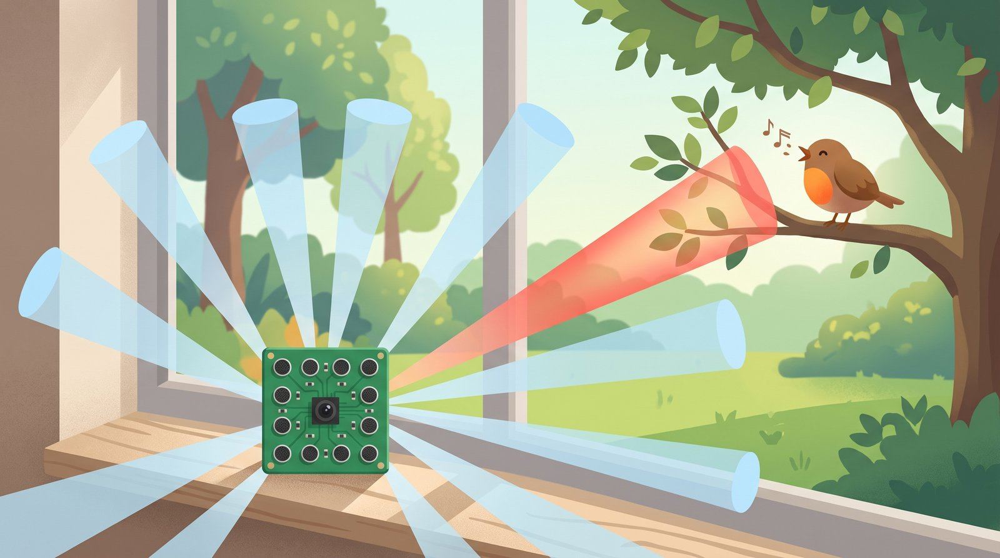
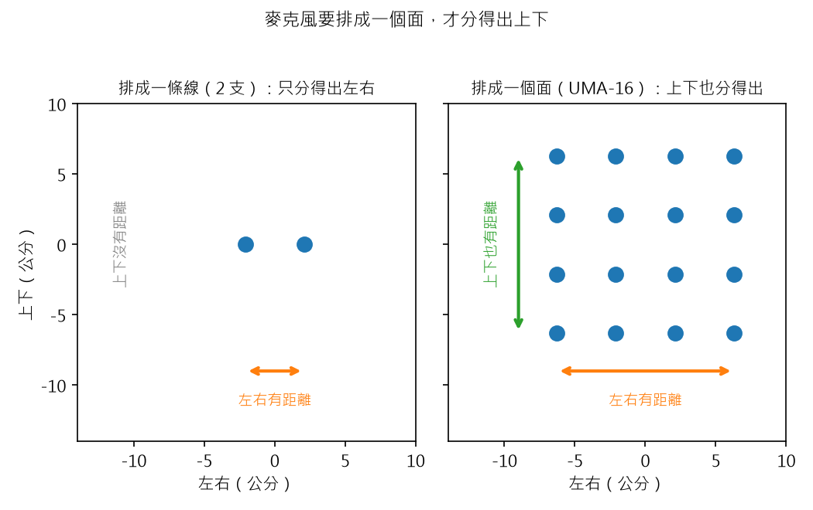
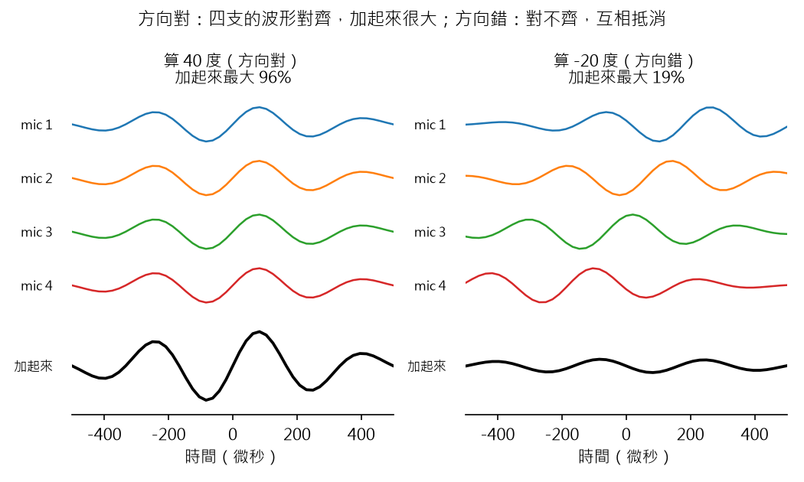
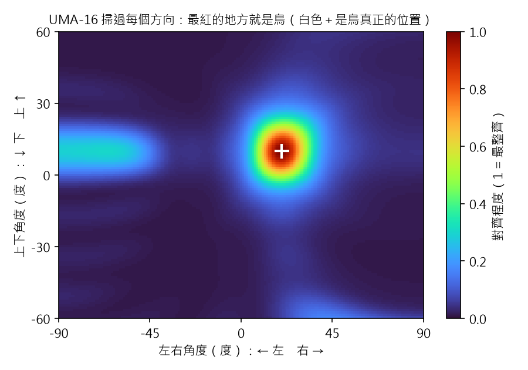
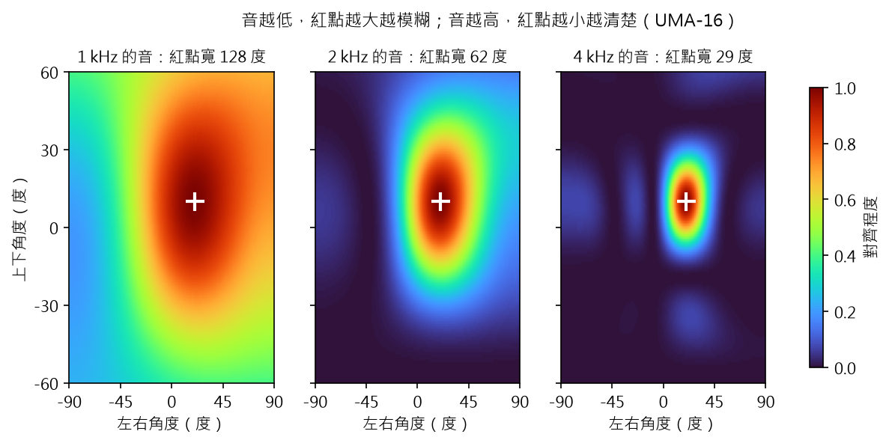
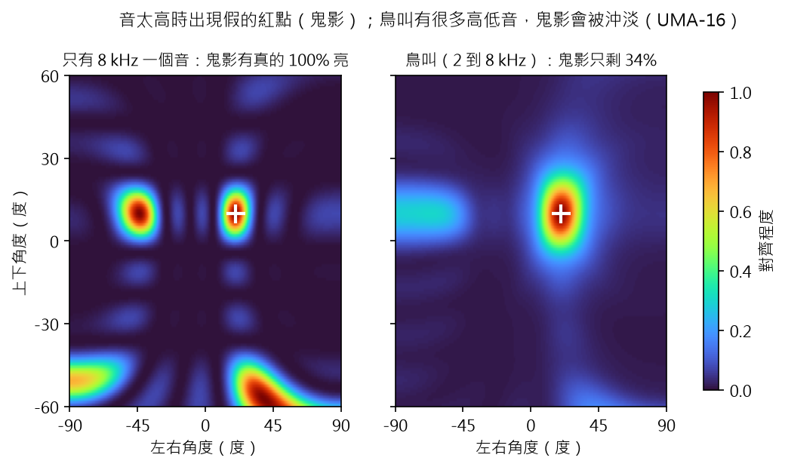
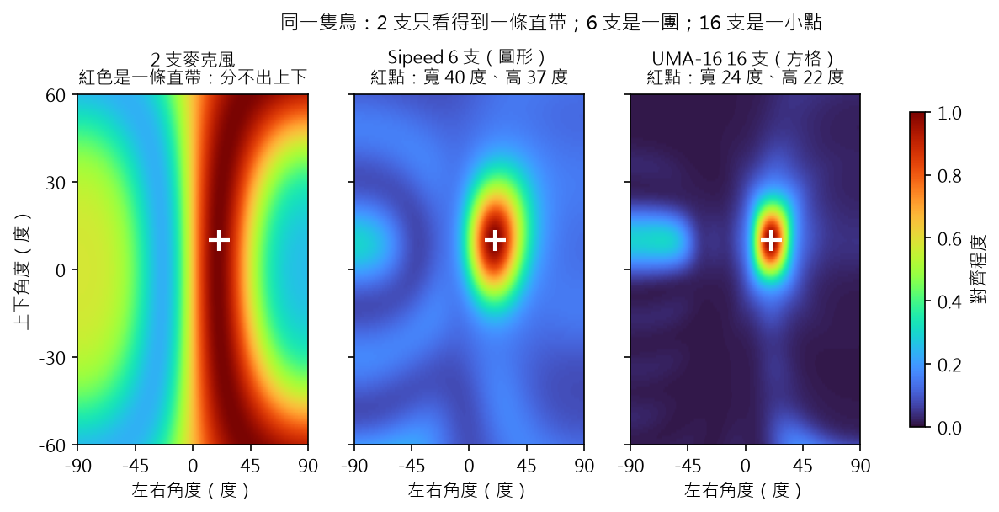
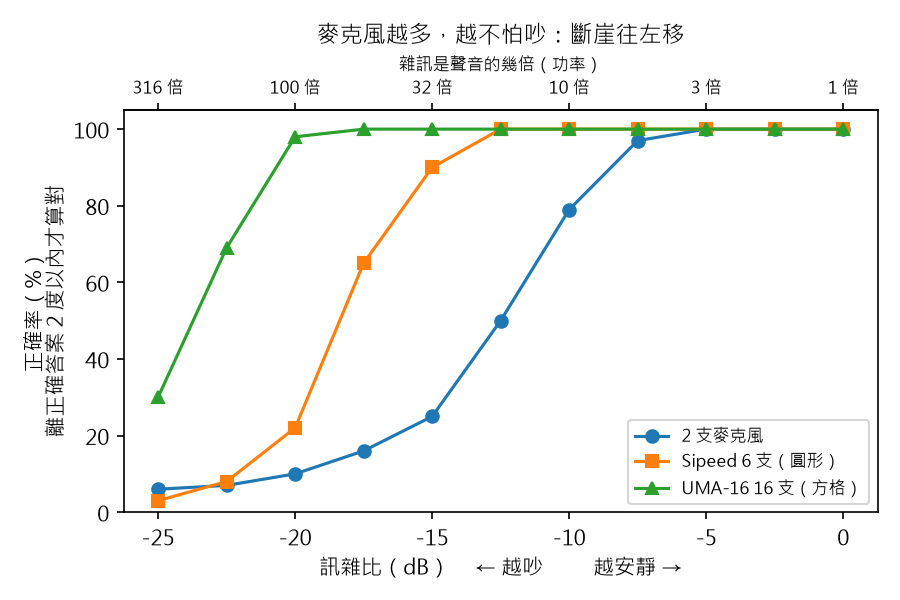

# 聲音相機 #2：16 支麥克風，怎麼畫出一張聲音地圖？

> 草稿（Claude 起稿，Aaron 改寫後發布）。數字全部來自 `scripts/step2_sound_map.py`，
> 程式碼在 GitHub tag `step-2`。寫給 12 歲的讀者；「深入一點」可以跳過。

## 重點摘要：這篇會教你的 3 件事

1. **麥克風排成一個面，才分得出上下。** 再把每個方向都猜一次，聲音對得最整齊的方向，就是鳥。
2. **板子越寬、浪頭越短，紅點越小，位置越準。** 像海上的浮板：浪很長時，整塊一起上下，
   感覺不出浪從哪來；浪很短時，一頭高一頭低，馬上知道。鳥叫是高音，浪頭短，所以找得準。
3. **麥克風越多，越不怕吵。** 所以要找鳥，麥克風多、排成方格的大板子，比小小的圓形板子好。

上一篇，兩支麥克風只能告訴我「鳥在左邊幾度」，分不出上下。可是鳥可能在樹梢，也可能在樹根。
這一篇，我要用 16 支麥克風，畫出一整張「聲音地圖」：哪裡紅，鳥就在哪裡。

還是先不買硬體，全部在電腦裡模擬。這一篇模擬的結果，也會決定我要買哪一塊麥克風板。

## 1. 一條線只分得出左右，排成一個面才分得出上下

你的兩隻耳朵一左一右，所以很會分左右；可是聲音從頭頂還是腳下來，就難分多了。
有一種貓頭鷹叫倉鴞，牠的兩個耳孔**一高一低**。聲音從上面來，高的耳朵先聽到；從下面來，低的先聽到。
所以牠在黑暗裡，也聽得出草叢裡的老鼠在哪裡。

麥克風也一樣：

- **兩支排成一條線（第一篇）：** 只有左右的距離，只比得出左右。鳥在樹梢或樹根，兩支聽到的時間差都一樣。
- **排成一個面：** 左右有距離，上下也有距離。左右隔開的麥克風比出左右，上下隔開的比出上下。

- **左圖：** 第一篇的 2 支麥克風，只有橘色的左右距離，沒有上下距離。
- **右圖：** UMA-16 的 16 支排成 4 × 4 的方格，橘色的左右距離和綠色的上下距離都有。

所以從「一個角度」升級成「一張地圖」，要的就是這件事：**麥克風不能排成一條線，要排成一個面。**
最少 3 支、不在同一條線上就夠了；多放幾支，地圖會更清楚，後面會說。

> **深入一點：** 兩支麥克風只量得到一個時間差，等於只知道聲音方向和那條線的夾角。
> 夾角一樣的方向排成一個圓錐，所以地圖上是一整條帶子。第三支不在線上的麥克風給出第二個時間差，
> 兩個圓錐交在一起，才剩下一個方向（還有前後照鏡子的那一個，第 8 節會說）。

## 2. 每個方向都猜一次：猜對時，大家齊步走

麥克風排成一個面之後，要怎麼畫出地圖？上一篇說過：聲音從某個方向來，每支麥克風聽到的時間會差一點點。
現在反過來想：**如果我猜「鳥在右邊 40 度」，就能算出每支麥克風應該晚多少。**

於是我把每支麥克風的聲音，照「猜的方向」往回挪一點，再全部加起來：

- **猜對了：** 挪完之後，每支麥克風的波形剛好對齊，像運動會進場時齊步走，步伐一致。加起來就很大聲。
- **猜錯了：** 挪完還是對不齊，有的往上、有的往下，互相抵消。加起來就很小聲。

這張圖用一排 4 支麥克風，聲音從 40 度來。左邊猜 40 度（猜對），加起來的高度是完美對齊的 96%；
右邊猜 -20 度（猜錯），只剩 19%。

接下來，把左右 -90 到 90 度、上下 -60 到 60 度的每一個方向都猜一次，
把「加起來有多大聲」塗上顏色，就是一張聲音地圖：

- **橫軸：** 左右角度，往右是正的。**縱軸：** 上下角度，往上是正的。
- **顏色：** 對齊程度。紅色是對得最整齊（1），深藍是對不齊（0）。
- **白色＋：** 我在模擬裡放鳥的位置（右邊 20 度、往上 10 度）。最紅的地方剛好就在這裡。
- 左邊那一團淡淡的藍綠色，是「鬼影」，第 4 節會說明。

> **深入一點：** 這個方法叫「延遲相加」（delay-and-sum beamforming）。麥克風在位置 p，
> 聲音方向是 u 時，它聽到的延遲是 -(p · u) / c。每個方向 u 都把延遲補回來再相加，算總功率。
> 和第一篇一樣，每個頻率先除以自己的大小（PHAT），讓每個高低音的權重相同。
> 板子：miniDSP UMA-16，4 × 4 方格，麥克風間距 4.2 公分；鳥叫：2 到 8 kHz 的掃頻音，
> 雜訊比它小 20 dB；地圖每 1 度一格。

## 3. 板子越寬、浪頭越短，紅點越小：像海上的浮板

上一篇說，聲音像海浪。**兩個浪頭之間的距離**，叫做「波長」。
低音的浪頭隔得很遠，高音的浪頭隔得很近。
（下面的 kHz 是「每秒震動幾千次」：1 kHz 是每秒 1,000 次，數字越大，音越高。）

- 1 kHz 的音：浪頭隔 34 公分。
- 4 kHz 的音：浪頭隔 8.6 公分。

UMA-16 這塊板子大約 13 公分寬。想像海上漂著一塊 13 公分的小浮板，你要靠它感覺浪從哪邊來：
浪頭很長的時候，整塊浮板幾乎在同一個浪頭上，跟著一起上下，感覺不出浪從哪邊來；
浪頭很短的時候，浮板一頭高、一頭低，斜一點點都感覺得到。

| 聲音 | 紅點寬幾度（UMA-16） | 紅點寬幾度（Sipeed 6 支） |
|---|---|---|
| 1 kHz | 128 度 | 整張地圖都紅 |
| 2 kHz | 62 度 | 116 度 |
| 4 kHz | 29 度 | 50 度 |

**發現：浪頭越短（音越高）、板子越寬，紅點越小，位置越準。** 鳥叫大多在 2 到 8 kHz，算是高音、浪頭短，
這對我們有利。Sipeed 的圓形板只有 8 公分寬，比 UMA-16 小，紅點也大很多。

> **深入一點：** 紅點寬度大約和「波長 ÷ 板子大小」成正比。波長 = 聲速 ÷ 頻率：
> 343 ÷ 1000 = 0.34 公尺；343 ÷ 4000 = 0.086 公尺。UMA-16 的寬度是 3 × 4.2 = 12.6 公分。
> 紅點寬度是「對齊程度 ≥ 0.5」的範圍（-3 dB）。

## 4. 音太高會出現鬼影：麥克風要比「半個浪頭」靠得更近

可是音不能一直變高。**到了 8 kHz，地圖上出現了第二個一樣紅的點**，但那裡根本沒有鳥：

你看過影片裡的車輪「倒著轉」嗎？車輪轉得太快，攝影機每一張照片之間，輪子轉了快一圈，
看起來就像倒著轉。這是「照片拍得不夠密」造成的錯覺。

麥克風也一樣。上一篇說麥克風會拍「聲音照片」；其實每支麥克風也像是在**不同位置**拍照。
如果麥克風之間隔得比半個浪頭還遠，就會被騙：某個錯的方向，看起來也對得很整齊。
這個假的紅點，叫做**鬼影**。

- **左圖，只有 8 kHz 一個音：** 鬼影和真的一樣亮（100%），根本分不出哪個是鳥。
- **右圖，鳥叫（2 到 8 kHz 很多高低音）：** 鬼影只剩真的 34%。

為什麼鳥叫的鬼影比較淡？因為**每個高低音的鬼影，出現在不同的地方**；
只有真正的鳥，每個高低音都同意。就像上一篇的評審投票：真的答案大家都投，
假的答案只有少數人投，加起來就被沖淡了。

> **深入一點：** 這叫「空間混疊」（spatial aliasing）。麥克風間距要小於半個波長，才不會有鬼影：
> 4.2 公分 × 2 = 8.4 公分，對應 343 ÷ 0.084 ≈ 4.1 kHz。高於 4.1 kHz，UMA-16 就可能出現鬼影。
> 鬼影亮度是「離紅點超過 15 度的地方，最亮是紅點的幾 %」。

## 5. 2 支、6 支、16 支：同一隻鳥，地圖長得完全不一樣

我把同一隻鳥（右邊 20 度、往上 10 度，鳥叫 2 到 8 kHz），分別給三種麥克風聽：

| 麥克風 | 地圖上看到什麼 | 鬼影亮度 |
|---|---|---|
| 2 支（第一篇） | 一條紅色直帶：知道左右，分不出上下 | — |
| Sipeed 6 支，排成圓圈，8 公分寬 | 一團紅點，寬 40 度、高 37 度 | 66% |
| UMA-16 16 支，排成方格，13 公分寬 | 一小點紅點，寬 24 度、高 22 度 | 34% |

- **2 支為什麼是一條直帶？** 第 1 節說過：排成一條線，只分得出左右。鳥在樹梢或樹根都一樣紅。
- **6 支和 16 支都畫得出點**，因為它們排成一個面。
- **16 支的紅點只有 6 支的大約一半寬，鬼影也只有一半亮。**

## 6. 麥克風越多，越不怕吵

第一篇的教室遊戲還記得嗎？雜訊太大時，答案會突然全錯，像掉下斷崖。

多幾支麥克風，就像**多幾隻耳朵一起聽**。每隻耳朵聽到的鳥叫都一樣，
但聽到的雜訊各不相同。加起來時，鳥叫越疊越大，雜訊互相抵消。

我讓鳥在右邊 20 度，把雜訊一路調大，每一格玩 100 次，看答案離 20 度不到 2 度的正確率：

| 雜訊是聲音的幾倍 | 2 支 | Sipeed 6 支 | UMA-16 16 支 |
|---|---|---|---|
| 10 倍 | 79% | 100% | 100% |
| 32 倍 | 25% | 90% | 100% |
| 100 倍 | 10% | 22% | 98% |
| 316 倍 | 6% | 3% | 30% |

**發現：麥克風越多，斷崖就往越吵的地方移。** 雜訊大 100 倍時，2 支幾乎是亂猜（10%），
16 支還有 98% 答對。遠處小聲的鳥，就是靠這個找到的。

> **深入一點：** 這是「陣列增益」：M 支麥克風把訊雜比提高大約 10 × log10(M) dB。
> 2 支到 16 支是 8 倍，大約 9 dB；圖上斷崖（正確率 50%）從 -12.5 dB 移到大約 -23.5 dB，
> 移了約 11 dB。只比較左右角度（鳥和麥克風同高），聽 0.1 秒，雜訊是寬頻白雜訊。

## 7. 模擬的結論：找鳥要用 16 支方格的 UMA-16

| 比較 | Sipeed 6 支 | UMA-16 16 支 |
|---|---|---|
| 鳥叫的紅點 | 寬 40 度 | 寬 24 度 |
| 鬼影 | 66% | 34% |
| 雜訊大 100 倍時的正確率 | 22% | 98% |
| 中間可以裝攝影機 | 否 | 是（板子中間有洞） |
| 價格 | 還要查 | 還要查 |

**模擬的結論：要找窗外的鳥，UMA-16 明顯比較好。** 紅點小一半、鬼影淡一半、更不怕吵，
中間還剛好能裝攝影機。Sipeed 便宜、小巧，但地圖太模糊。
**後來我改選了 Sipeed 加會轉的長鏡頭：** 我要的不是最清楚的地圖，而是把鳥拍下來。番外篇會說為什麼。

## 8. 這張地圖還做不到的事

- **它只是一張彩色的方格。** 我還看不到窗外的樹和鳥。下一篇要讓攝影機聽到鳥叫，
  自己轉頭去看，把鳥拍下來。
- **前後還是分不出來。** 麥克風排在一個平面上，聲音從正前方或正後方來，地圖看起來一樣。
  所以板子要面向花園、背後靠牆裝。

## 程式碼

- GitHub：https://github.com/HsinNan123/acoustic-camera （tag `step-2`）
- 核心：`acam/beamform.py`（聲音地圖）、`acam/geometry.py`（兩塊板子的麥克風位置）、`acam/sim.py`（模擬每支麥克風）
- 重現本文所有數字和圖：`python scripts/step2_sound_map.py`（大約 10 分鐘）
