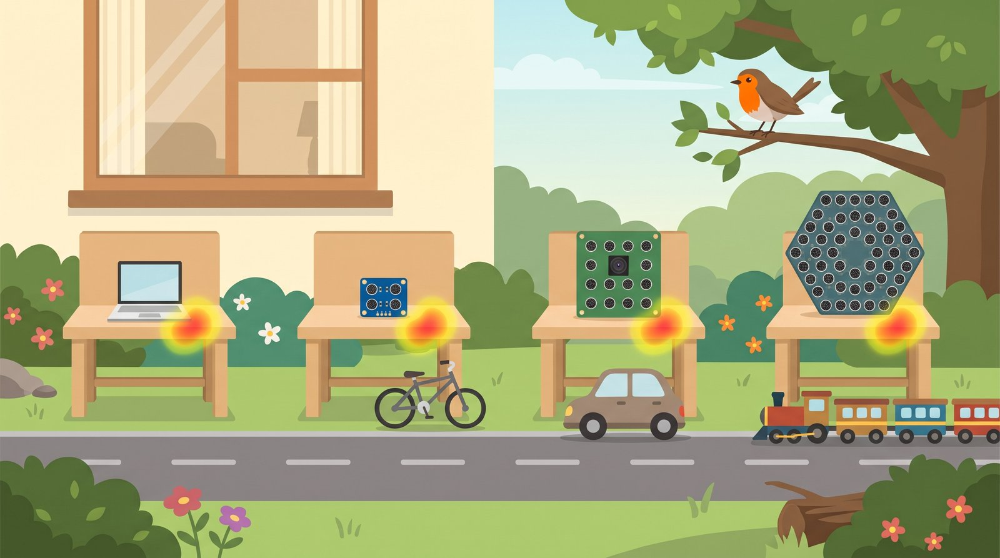
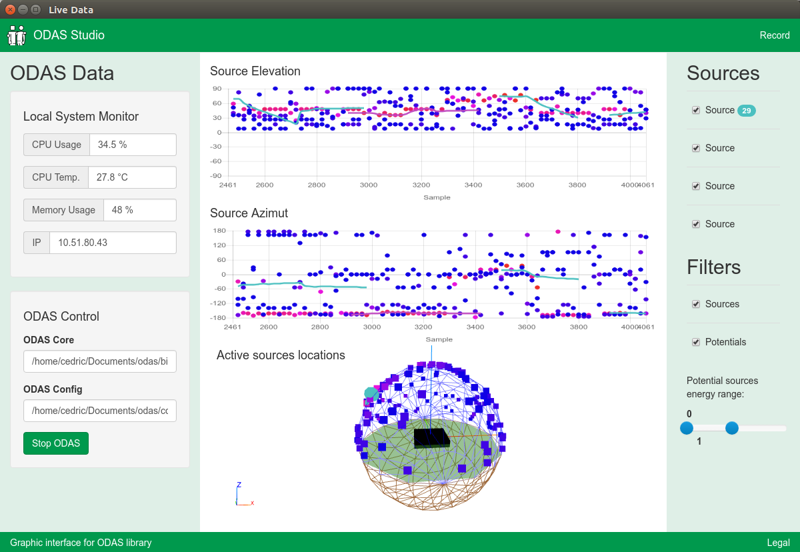
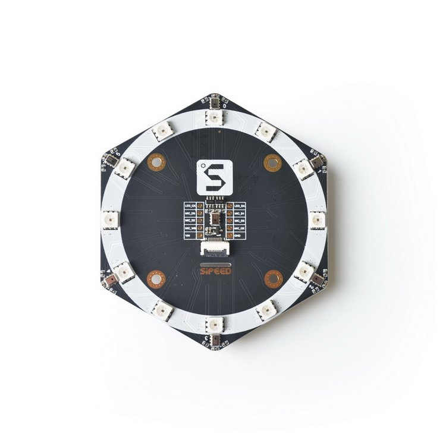
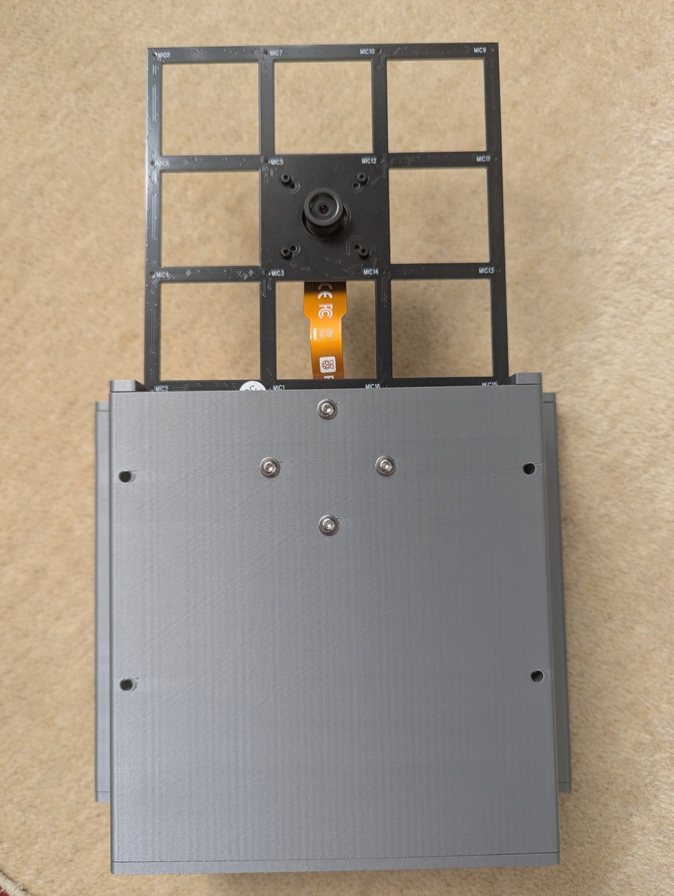
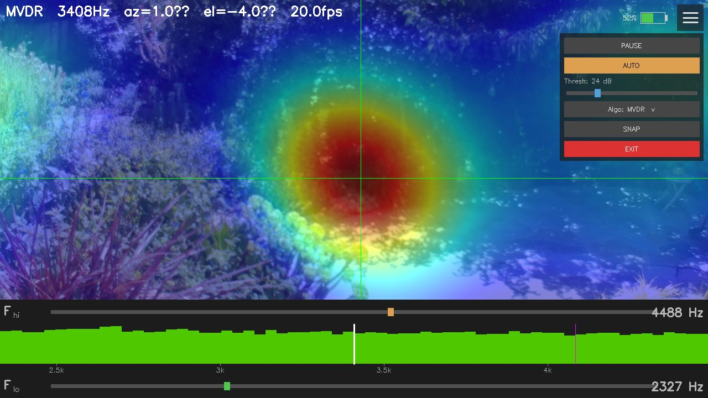
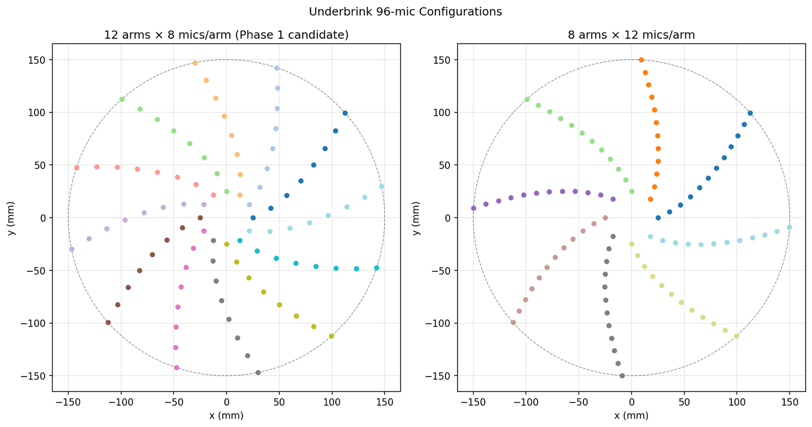
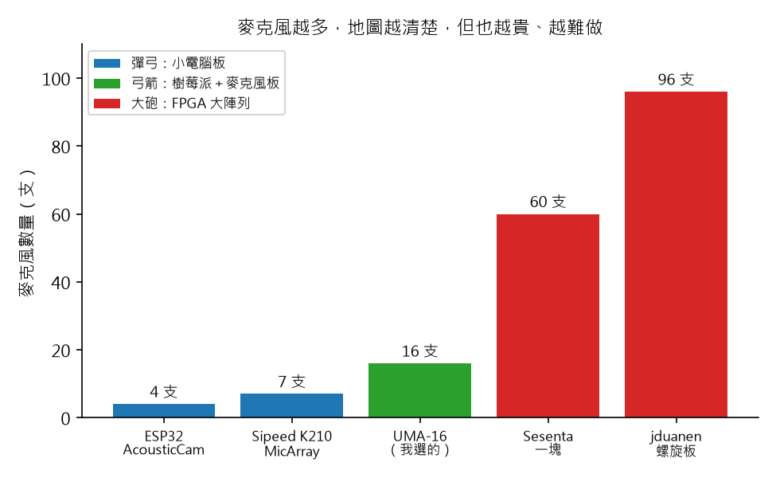

# 聲音相機 番外篇：從彈弓到大砲，全世界的人怎麼自己做聲音相機？

> 草稿（Claude 起稿，Aaron 改寫後發布）。專案資料來自 `docs/research/open-source-acoustic-cameras.md`，
> GitHub 數字查於 2026-10-25。寫給 12 歲的讀者；「深入一點」可以跳過。

## 重點摘要：這篇會教你的 3 件事

1. **自己做聲音相機的人很多，做法從小到大，就像彈弓、弓箭到大砲。** 還有一種是軟體，像瞄準鏡，裝在哪一種上面都能用。
2. **麥克風越多，地圖越清楚，但也越貴、越難做。** 就像大砲看得最遠，但你沒辦法自己在家造一門。
3. **我選的那條路，剛好是最多人走的路：** 樹莓派或筆電，加上一塊麥克風很多的方格板子。

前兩篇，我都在電腦裡模擬。寫著寫著我開始好奇：**世界上還有誰在自己做聲音相機？**
商店賣的聲學攝影機（acoustic camera）很貴，大多只賣給工廠和公司。
所以有很多人，乾脆自己動手做，再把設計圖和程式免費公開，讓大家一起改。這叫做「開源」。

我找了 14 個公開的專案，把它們分成四種做法。

## 1. 做法從小到大，就像彈弓、弓箭到大砲

拍鳥的人，本來就把拍鳥叫「打鳥」，把很長的望遠鏡頭叫「大砲」。
所以這篇的彈弓和大砲，都是拿來**聽鳥、看鳥**的，不會傷到任何一隻鳥。

| 工具 | 做法 | 麥克風 | 地圖 | 難度 |
|---|---|---|---|---|
| 瞄準鏡 | 只用軟體 | 自己準備 | 看你的麥克風 | 只要會寫程式 |
| 彈弓 | 小電腦板（ESP32、K210） | 4 到 7 支 | 很粗 | 便宜、好上手 |
| 弓箭 | 樹莓派＋USB 麥克風板 | 16 支 | 清楚 | 中等 |
| 大砲 | FPGA 大陣列 | 60 到 96 支 | 最清楚 | 要自己做電路板 |

**怎麼選？** 彈弓小小一把，口袋就裝得下，但打不遠；大砲看得最遠，但要一整隊人才搬得動。
找窗外的鳥，弓箭剛剛好。不管選哪一種，都可以裝上瞄準鏡。

> **深入一點：** 「小電腦板」是指 ESP32、K210 這種一顆晶片的小板子（微控制器）。
> 「FPGA」是一種可以自己設計電路的晶片，能同時處理很多支麥克風，但要會畫電路板、寫硬體程式。

## 2. 瞄準鏡：免費的軟體工具箱，每一種做法都用得到

瞄準鏡不會自己發射，但它幫你看準方向。軟體工具箱也一樣：它不是硬體，但幾乎每台自製聲音相機都用了它：

- **Acoular**：德國柏林工業大學做的 Python 工具箱，專門畫聲音地圖。前兩篇我自己寫的「齊步走」方法，它都有，還有更厲害的方法能把鬼影擦掉。
- **ODAS**：加拿大舍布魯克大學做的，可以在樹莓派上**即時追蹤**好幾個聲音，畫在一顆 3D 地球上。
- **pyroomacoustics**：可以模擬一整個房間的回音，適合學習。

- **上面兩張圖：** 聲音在哪個高度（上）、哪個左右方向（下），橫軸是時間。
- **下面的球：** 麥克風板在球中間，球上的每個點，是一個聽到的聲音。

## 3. 彈弓：小電腦板，便宜但地圖很粗

- **ESP32 AcousticCam**：一塊 ESP32 加 4 支麥克風和一顆小鏡頭。ESP32 負責收聲音和影像，
  再傳給電腦，由電腦畫熱力圖。作者正在做第二版，想讓 ESP32 自己畫。
- **Sipeed K210 MicArray**：7 支麥克風（6 支排成一圈、中間 1 支），接上 K210 小電腦板，
  **板子自己就能畫出聲音地圖**，顯示在小螢幕上。第二篇比較過的 Sipeed 圓形板，就是這塊麥克風板。

**為什麼地圖很粗？** 第二篇發現過：麥克風少、板子小，紅點就大，鬼影也多。
彈弓很輕巧，但打不遠。

## 4. 弓箭：樹莓派＋16 支麥克風板，最多人走的路

- **Benn Jordan 的「400 美元聲音相機」**：YouTuber Benn Jordan 用 miniDSP UMA-16（16 支麥克風）、
  樹莓派 5（一台信用卡大小的小電腦）和一顆鏡頭，再加上 Acoular。他用它**在樹上找到了一隻老鷹**，也聽出一群雞裡是哪一隻在叫。
- **jduanen 的聲音相機**：一步一步升級：先模擬，再用 4 支麥克風的板子，再用 UMA-16，
  現在正在畫 96 支麥克風的電路板。

- **第一張：** 這就是我想買的 UMA-16，鏡頭裝在正中間，聲音地圖和畫面才會對得準。
- **第二張：** 這就是聲音相機做完的樣子。下一篇，我也要做出這樣的畫面。

**這兩位，都走過我現在走的路：先模擬，再買 UMA-16。** 第二篇模擬選出 UMA-16，原來不只我這樣選。

## 5. 大砲：FPGA 大陣列，最清楚但最難做

- **Sesenta**：一塊板子上就有 60 支麥克風，而且可以像拼圖一樣拼起來：拼 7 塊，就是 420 支。
  電路圖全部公開，2026 年 1 月已經做出 8 支麥克風的示範。
- **jduanen 的 96 支螺旋板**：96 支麥克風排成螺旋形，大約 30 公分寬。電路板還在畫，還沒做出來。

- **每個點：** 一支麥克風。**同一個顏色：** 一條手臂。左邊是 12 條手臂、每條 8 支，右邊是 8 條手臂、每條 12 支。
- **注意：** 點和點之間的距離，每一對都不一樣。下面的「深入一點」說為什麼。

- **藍色（彈弓）：** 4 到 7 支。**綠色（弓箭）：** 16 支，就是我選的 UMA-16。**紅色（大砲）：** 60 到 96 支。
- 第二篇發現：麥克風越多，紅點越小、越不怕吵。大砲那一層，就是把這件事做到極致。

> **深入一點：** 為什麼螺旋形？第二篇說過，麥克風排得太整齊、隔得太開，高音會出現鬼影。
> 排成螺旋，每兩支之間的距離都不一樣，鬼影就會散開、變淡。這和鳥叫用很多高低音沖淡鬼影，是同一個道理。

## 6. 沒有 Arduino 版的聲音相機：吸管太細，喝不了 16 杯飲料

我原本以為 Arduino 社群一定有人做，結果找不到一台真正的。原因很簡單：**太多聲音，吸管太細。**

16 支麥克風，每支每秒拍 48,000 張聲音照片，加起來每秒有 76 萬 8 千張，要同時收進來。
一般的 Arduino（像 Uno）就像一根細吸管，要同時喝 16 杯飲料，根本吸不過來。
所以小板子的做法，通常是把聲音傳給電腦，讓電腦來畫地圖。

> **深入一點：** 16 支 × 每秒 48,000 個取樣點 × 每點 2 位元組 = 每秒大約 1.5 MB。
> Arduino Uno 的記憶體只有 2 KB，連 2 毫秒的聲音都放不下。ESP32、樹莓派、FPGA 才跟得上。

## 7. 「開源」不等於「隨便拿」：先看授權

開源專案通常會附一張「授權」（license），說明別人可以怎麼用：

- **可以拿來用、也可以改，只要註明出處：** 像 Acoular（BSD）、ODAS、pyroomacoustics 和 jduanen 的專案（MIT）。
- **可以用；但如果你把改過的版本分享出去，也要公開你的程式：** 像 GPL。
- **沒寫授權：** 我找到的專案裡，有好幾個沒寫。這代表**只能看、只能學，不能直接拿來用**。

所以這篇的照片，只用有授權、允許轉用的專案，每張都寫了出處。
沒寫授權的專案（像 ESP32 AcousticCam、Sesenta），我只用自己的話介紹，照片請到原作者的頁面看。

## 8. 我走弓箭這條路：UMA-16 加筆電或樹莓派

**拉弓：UMA-16，接筆電或樹莓派。** 第二篇的模擬選了它，這次的調查又看到兩位前輩也這樣走。

我也會裝上瞄準鏡：之後用 **Acoular** 的方法把鬼影擦掉，鳥飛來飛去時，再試試 **ODAS** 的追蹤。
下一篇回到正題：把聲音地圖疊到攝影機畫面上。

## 連結（沒有授權的專案，請到原作者頁面看圖和程式）

- Acoular：https://github.com/acoular/acoular
- ODAS：https://github.com/introlab/odas
- pyroomacoustics：https://github.com/LCAV/pyroomacoustics
- ESP32 AcousticCam：https://github.com/22carlo22/AcousticCam
- Sipeed MicArray：https://wiki.sipeed.com/hardware/zh/modules/micarray.html
- Benn Jordan 的聲音相機（Hackaday 報導）：https://hackaday.com/2024/10/10/building-a-sound-camera-for-under-400/
- jduanen 的聲音相機：https://github.com/jduanen/Acoustic-Camera
- Sesenta：https://hackaday.io/project/192750-sesenta-open-source-tileable-acoustic-camera
- 我自己的程式：https://github.com/HsinNan123/acoustic-camera

## 圖片出處與授權

| 圖 | 出處 | 授權 |
|---|---|---|
| ODAS 畫面 | IntRoLab，[introlab/odas_web](https://github.com/introlab/odas_web)（screenshots/live_data.png） | MIT，Copyright (c) 2019 IntRoLab |
| Sipeed 麥克風板 | Sipeed，[sipeed/sipeed_wiki](https://github.com/sipeed/sipeed_wiki)（mic_array.jpg） | MIT，Copyright (c) 2021 Neucrack |
| jduanen 第三版、螢幕、96 支設計圖 | Duane Northcutt，[jduanen/Acoustic-Camera](https://github.com/jduanen/Acoustic-Camera) | MIT，Copyright (c) 2025 Duane Northcutt |
| 示意圖 | Gemini 生成 | — |
| 麥克風數量圖 | 本專案自繪 | MIT |

照片經縮小，內容未修改。MIT 授權全文：https://github.com/HsinNan123/acoustic-camera/blob/main/docs/blog/img/THIRD_PARTY.md
