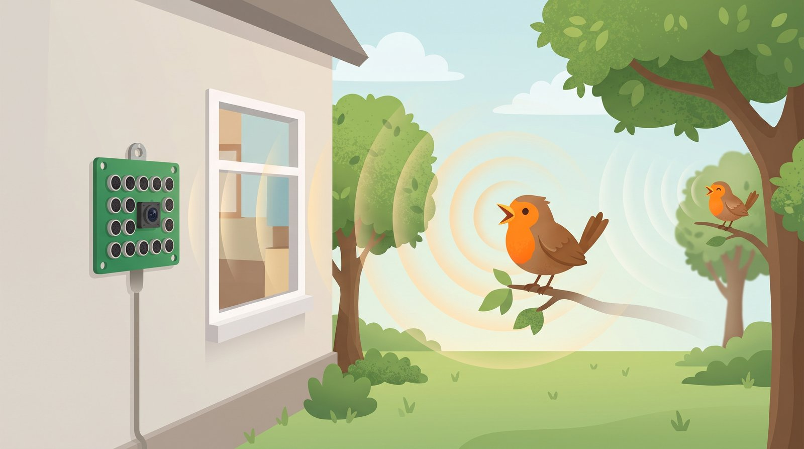
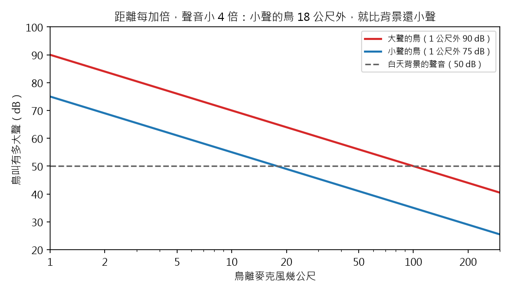
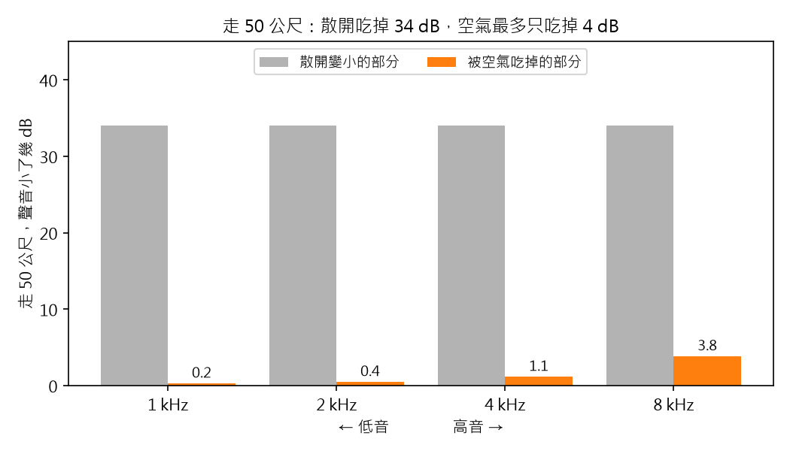
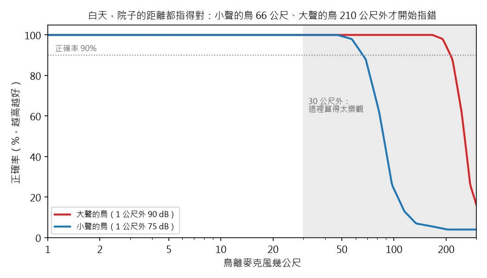

# 聲音相機 番外篇 2：鳥在多遠，麥克風還找得到？

> 草稿（Claude 起稿，Aaron 改寫後發布）。數字全部來自 `scripts/bonus2_how_far.py`。
> 鳥叫和背景聲音的大小來自文獻（文末「資料來源」），還沒有在我家院子實測。
> 寫給 12 歲的讀者；「深入一點」可以跳過。

## 重點摘要：這篇會教你的 3 件事

1. **鳥離得越遠，叫聲越小。** 聲音像噴漆一樣散開，離越遠，散得越開、越淡。
2. **找不找得到，要看鳥叫比背景的聲音大多少。** 就像在吵雜的教室裡聽悄悄話。
3. **在院子這麼近的距離，大聲和小聲的鳥都找得到。** 6 支麥克風一起聽，鳥叫比背景小也沒關係。

前兩篇的模擬，鳥都在「很遠、方向固定」的地方，我只問：方向找得對不對？
可是真的院子裡，鳥有近有遠，有的大聲、有的小聲，旁邊還有車聲和冷氣聲。
麥克風板還在寄來的路上，我先算一算：鳥在多遠，Sipeed 的 6 支麥克風還找得到？

## 1. 距離加倍，聲音小 4 倍

用噴漆罐噴牆：離牆很近，噴出一小塊很濃的顏色；離牆遠一點，噴到的範圍變大，顏色變淡。
油漆一樣多，只是被分到更大的面積上。

聲音也是這樣。鳥叫一聲，聲音往四面八方散開，像一個越吹越大的泡泡。
離鳥越遠，同樣的聲音被分到越大的泡泡表面上，聽起來就越小聲。
**距離每加倍，聲音就小 4 倍（-6 dB）。** dB 是聲音大小的倍數尺，像地震規模：每 -10 dB，就小 10 倍。

- **紅線：** 大聲的鳥，1 公尺外 90 dB，像紅翅黑鸝（文獻量到的）。
- **藍線：** 小聲的鳥，1 公尺外 75 dB。很多小型鳴禽在 80 dB 以下，我挑 75 dB 當例子。
- **灰色虛線：** 白天背景的聲音，50 dB，像安靜的住宅區（車聲、冷氣聲、風吹樹葉）。
- 橫軸每一格是加倍：1、2、5、10、20、50 公尺……兩條線都是直直往下的斜線。

小聲的鳥到了 18 公尺外，就比背景還小聲。大聲的鳥要到 100 公尺外，才比背景小聲。

> **深入一點：** 聲音大小 = 1 公尺外的大小 - 20 × log10(距離)。距離 2 倍，少 20 × log10(2) = 6 dB。
> 聲音的能量分到球的表面上，球的面積和距離的平方成正比，所以距離 2 倍，能量變 1/4。
> 程式是 `acam/propagation.py` 的 `level_at()`。

## 2. 空氣會吃掉高音，但院子的距離吃得不多

打雷的時候，近的雷是「啪！」一聲很尖；遠的雷只剩低低的「轟隆隆」。
因為聲音在空氣裡走，空氣會把一點點聲音變成熱，**音越高，被吃掉的越多。** 走得越遠，高音就越少。

鳥叫大多是高音（2 到 8 kHz），所以我算了一下：空氣會吃掉多少？

- **灰色：** 走 50 公尺，聲音因為散開而小了 34 dB。每種高低音都一樣。
- **橘色：** 同樣 50 公尺，被空氣吃掉的部分。音越高，吃得越多：1 kHz 只有 0.2 dB，8 kHz 有 3.8 dB。

**發現：在院子的距離，空氣吃掉的不多，散開才是聲音變小的主因。** 打雷要隔好幾公里，空氣才吃得出差別。

> **深入一點：** 空氣吃掉多少，用國際標準 ISO 9613-1 的公式計算（20°C、相對濕度 70%）。
> 程式算出的值和標準的表格差不到 5%（`tests/test_propagation.py`）。空氣越乾，高音被吃得越多：
> 濕度 20% 時，8 kHz 走 50 公尺會被吃掉 10.6 dB。

## 3. 鳥叫要比背景的聲音大，才找得到

在吵雜的教室裡，同學在你旁邊說悄悄話，你可能聽不清楚。不是因為他太小聲，是因為旁邊太吵。
麥克風也一樣：找不找得到鳥，要看**鳥叫比背景的聲音大多少**。第一篇說過，這叫做訊雜比。

那麥克風自己會不會太吵？麥克風本身也有一點點沙沙聲。Sipeed 板子用的麥克風，自己的沙沙聲大約 37 dB，
比白天的院子（50 dB）還小 13 dB（小 20 倍）。

| 聲音 | 大小 |
|---|---|
| 白天的院子（安靜的住宅區） | 50 dB |
| 晚上的院子（清晨大概也這麼安靜，這是推測） | 40 dB |
| 麥克風自己的沙沙聲 | 37 dB |

**發現：在院子裡，限制我的是院子的背景聲音，不是麥克風。** 換更好的麥克風，也聽不到更遠的鳥。

> **深入一點：** 麥克風規格表寫訊雜比 57 dB（A 加權），意思是：94 dB 的聲音進來，
> 麥克風自己的雜訊比它小 57 dB，也就是 94 - 57 = 37 dB。

## 4. 院子裡的距離，大聲和小聲的鳥都找得到

第二篇說過：麥克風越多，越不怕吵，就像多幾隻耳朵一起聽。
Sipeed 有 6 支麥克風一起聽，所以就算鳥叫比背景小很多，還是常常指得對。

我先在電腦裡模擬：雜訊從小到大，每一種讓 Sipeed 找 100 次鳥。
指的方向離鳥 10 度以內，就算指對（長鏡頭一次看 57 度，10 度以內鳥一定在畫面裡）。
再把第 1 節的距離換算進去，就知道鳥在多遠，正確率是多少。

- **紅線：** 大聲的鳥（90 dB）。
- **藍線：** 小聲的鳥（75 dB）。
- **灰色點線：** 正確率 90%。線掉到這裡以下，就開始常常指錯。
- **灰色區域：** 30 公尺以外。這裡的樹葉和地面會讓叫聲更小，模擬沒有算，所以算得太樂觀。
- 背景是白天的 50 dB。正確率 = 100 次裡指對的比例。

**發現：白天，小聲的鳥在 66 公尺內、大聲的鳥在 210 公尺內，正確率都在 90% 以上。**
過了這個距離，正確率很快就掉下去，就像第一篇說的斷崖。
我家院子只有十幾公尺，兩隻鳥都在「指得對」的範圍裡。
清晨比較安靜（40 dB），範圍更大：小聲的鳥 149 公尺，大聲的鳥超過 300 公尺。

所以在院子裡，**距離不是問題**。真正的麻煩，可能是回音和樹葉。

> **深入一點：** 正確率 90% 時，鳥叫可以比背景小 13.6 dB（小 23 倍）；正確率 50%（斷崖）在 -16.7 dB。
> 鳥叫是 0.1 秒、2 到 8 kHz。模擬把背景聲音全部放在 2 到 8 kHz 裡，這是最壞的情況：
> 真的背景聲音大多是低音（車聲），只聽 2 到 8 kHz 時會被濾掉。可是 30 公尺外，樹葉和地面
> 會讓叫聲更小，模擬沒有算。所以 30 公尺內的結果可以相信，更遠的只能參考。
> 空氣吃掉的部分用 5 kHz 計算。

## 5. 這個估計還沒算到的事

- **樹葉和地面。** 文獻量到：30 公尺以外，樹葉和地面會讓鳥叫額外變小，比這裡算的還小。
- **回音。** 聲音碰到地面和牆會彈回來，地圖上會不會多出假的鳥？下一個番外篇來算。
- **真的鳥。** 每種鳥的叫聲大小不一樣，同一隻鳥也會忽大忽小。等板子到了，在院子裡實測。

## 資料來源

- 紅翅黑鸝 1 公尺外的叫聲大約 90.8 dB：Brenowitz, E. A. (1982). The active space of red-winged blackbird song.
  *Journal of Comparative Physiology* 147: 511–522. 同一篇也寫到 30 公尺外會有額外的衰減。
- 很多小型鳴禽在 80 dB 以下：Brumm, H. 等人 (2025). A comparative analysis of song amplitude across and within
  bird species. 資料集：https://doi.org/10.5061/dryad.cnp5hqchb
- 安靜的都市白天 50 dB、晚上 40 dB：加州交通局 Caltrans, Technical Noise Supplement (2013)。
- 空氣吃掉的聲音：ISO 9613-1 (1993)，表格值來自 ISO 9613-2 表 2。
- 麥克風 MSM261S4030H0 訊雜比 57 dB：Sipeed wiki，https://wiki.sipeed.com/hardware/zh/modules/micarray.html

## 程式碼

- GitHub：https://github.com/HsinNan123/acoustic-camera
- 核心：`acam/propagation.py`（散開和空氣吃掉的部分）、`acam/beamform.py`（聲源定位地圖）
- 重現本文所有數字和圖：`python scripts/bonus2_how_far.py`
