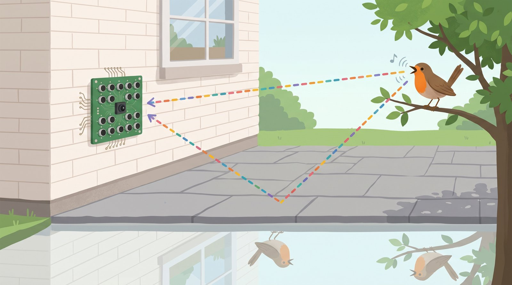
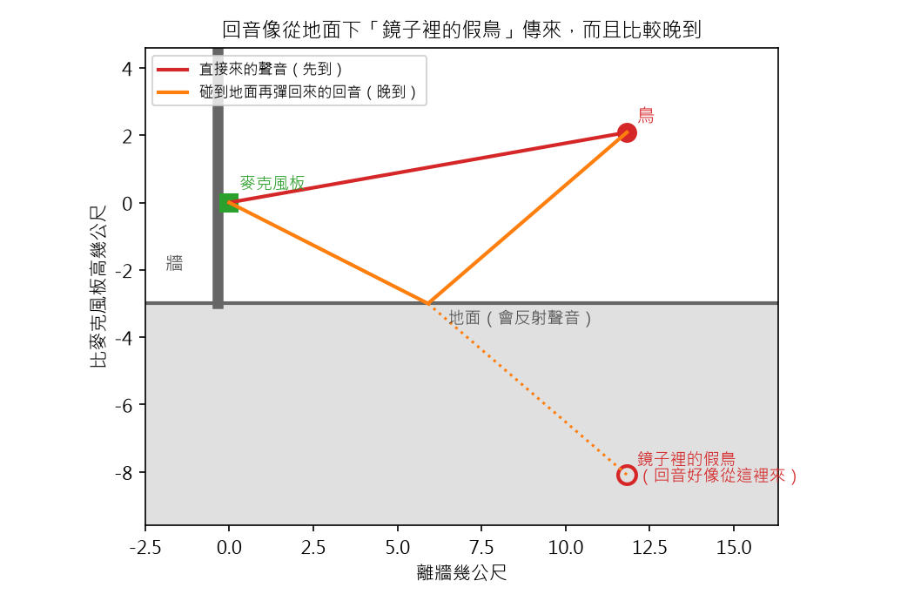
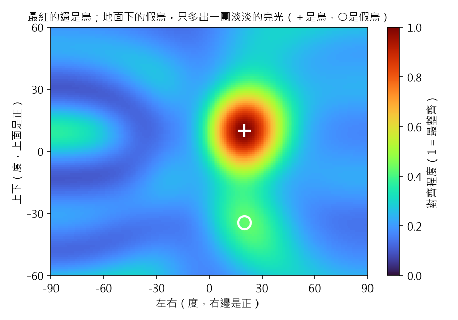
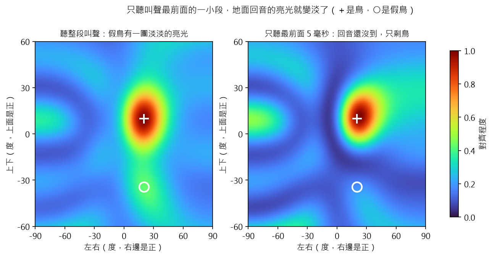
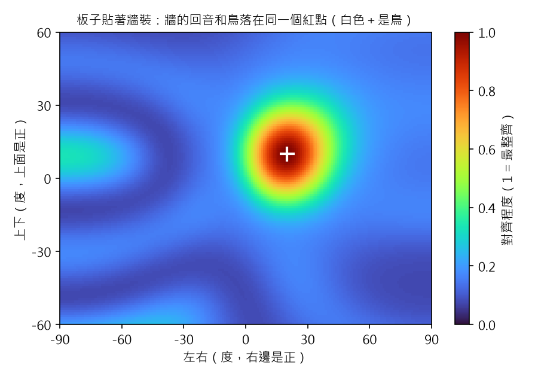

# 聲音相機 番外篇 3：地面和牆的回音，會騙麥克風嗎？

> 草稿（Claude 起稿，Aaron 改寫後發布）。數字全部來自 `scripts/bonus3_echoes.py`。
> 地面和牆反射多少聲音是假設，還沒有實測。寫給 12 歲的讀者；「深入一點」可以跳過。

## 重點摘要：這篇會教你的 3 件事

1. **聲音碰到地面會彈回來，聽起來好像從地面下的「假鳥」傳來。**
2. **直接來的聲音走最短的路，最先到。** 只聽叫聲最前面的一小段，回音就混不進來。
3. **板子貼著牆裝，牆的回音和真的鳥會疊在同一個地方。** 所以牆不會多出假的位置。

麥克風板會裝在家裡的外牆上，下面是鋪地磚的院子。地磚和牆都很硬，聲音碰到會彈回來，這就是回音。
板子同時聽到真的鳥和回音，聲源定位地圖會不會多出一隻不存在的鳥？還在等板子寄來，我先在電腦裡模擬。

## 1. 聲音碰到地面會彈回來，好像從地面下傳來

打撞球的時候，球撞到桌邊會彈回來。撞球高手有一個小技巧：
把桌邊想成一面鏡子，瞄準「鏡子裡的球袋」，球彈一次就會進洞。

聲音也一樣。鳥叫碰到地面彈上來，麥克風聽到的回音，就像從地面下方「鏡子裡的鳥」傳來。
這篇把它叫做**假鳥**：它不存在，只是回音好像從那裡來。

- **紅線：** 鳥叫直接飛到麥克風板，走最短的路。
- **橘線：** 鳥叫先碰到地面，再彈到麥克風板。
- **虛線和空心圓：** 把橘線拉直，就指到地面下的假鳥。假鳥和鳥一樣高，只是在地面的另一邊。
- 這個例子：麥克風板離地 3 公尺，鳥在 12 公尺外的樹上、離地 5.1 公尺。

從麥克風板看，假鳥在鳥的正下方，往下 34 度。回音多走了 2.32 公尺，所以晚到 6.8 毫秒
（1 毫秒是 1 秒的千分之一）。

> **深入一點：** 這叫「鏡像聲源法」。地面當作一面鏡子，假鳥的位置是鳥對地面的鏡像：
> 高度 5.1 公尺，變成地面下 5.1 公尺。程式是 `acam/geometry.py` 的 `mirror()`。
> 模擬假設地磚反射 90% 的聲壓；草地會吸收比較多，回音會比較小。

## 2. 直接來的聲音最先到，也最大聲

回音走的路比較長，所以比較晚到；碰到地面時，也會被吃掉一點，所以比較小聲。
這個例子裡，回音比鳥叫小 2.4 dB（小 1.7 倍）。

所以聲源定位地圖上，最紅的還是真的鳥。假鳥只會多出一團淡淡的亮光：

- **白色＋：** 鳥真正的位置（右 20 度、上 10 度），也是最紅的地方。
- **白色圓圈：** 假鳥的位置（右 20 度、下 34 度）。這裡的對齊程度是 0.43，不到鳥的一半。
- 這張地圖用的是 Sipeed 的 6 支麥克風，所以紅點比較大（第二篇第 5 節說過原因）。

## 3. 只聽叫聲最前面的一小段，回音就混不進來

你的耳朵其實每天都在做這件事。在浴室裡，聲音到處反彈，你還是聽得出朋友在哪裡叫你。
因為大腦會相信**最先到**的聲音，晚一點才到的回音，就不拿來判斷方向。

電腦也可以這樣做：先找出叫聲從哪一刻開始，只拿最前面 5 毫秒來計算。
這時回音還要再過 6.8 毫秒才會到，所以這一小段裡，只有真的鳥。

- **左圖：** 聽整段叫聲，假鳥的位置有一團淡淡的亮光（0.43）。
- **右圖：** 只聽最前面 5 毫秒，假鳥的亮光變淡了（0.18）。
- 右圖最紅的地方偏了一點，在右 23 度、上 11 度，因為只聽了很短的一段。

**發現：只聽最前面一小段，回音就混不進來。** 代價是聽的時間變短，位置會稍微不準一點。
對長鏡頭來說，偏 3 度沒有關係，鳥還在畫面裡。

> **深入一點：** 找開頭的方法：把 6 支麥克風的聲音大小平均、抹平，第一次超過最大值 10% 的地方，
> 再往前 1 毫秒。程式找到的開頭比真的早 1.2 毫秒。模擬的叫聲是 4 個短音，
> 每個 20 毫秒、從 8 kHz 滑到 2 kHz，開頭很乾脆，像真的鳥叫。
> 人耳的這個本領叫做「優先效應」。

## 4. 板子貼著牆裝，牆的回音不會多出假的位置

第二篇說過：麥克風排成一個平面，分不出正前方和正後方，就像照鏡子。
牆的回音剛好利用了這一點。板子在牆前 5 公分，牆的假鳥在牆後面，剛好就是鳥在鏡子裡的位置。
板子本來就分不出前後，所以牆的回音和真的鳥，算出來是**同一個方向**。

- **白色＋：** 鳥真正的位置。只有一個紅點，就在鳥身上。
- 牆的回音只多走 9.3 公分，晚 0.27 毫秒，幾乎和鳥叫同時到。

**發現：板子貼著牆裝，牆的回音不會多出假的位置。** 所以第二篇說「背後靠牆裝」，這裡有了原因。

> **深入一點：** 回音和直接的聲音差 0.27 毫秒，疊在一起時，有些高低音會互相抵消
> （2 到 8 kHz 裡，大約是 5.6 kHz），有些會變大。方向不會變，只是聲音的顏色變了一點。

## 5. 這個模擬還沒算到的事

- **只有一面地面和一面牆。** 真的院子還有屋簷、鄰居的牆和樹。
  旁邊的牆會在地圖左右多出假鳥，不能靠「貼著牆裝」解決，要靠第 3 節的方法。
- **鳥被樹葉擋住時，** 直接來的聲音會變小，回音可能比鳥還大聲。這要等板子到了，在院子裡實測。

下一個番外篇：麥克風說「右邊 20 度」，相機畫面要看哪裡？

## 程式碼

- GitHub：https://github.com/HsinNan123/acoustic-camera
- 核心：`acam/geometry.py`（`mirror()`：假鳥的位置）、`acam/sim.py`（`point_source()`：近處的鳥，聲音照距離變小、變晚）
- 重現本文所有數字和圖：`python scripts/bonus3_echoes.py`（大約 30 秒）
