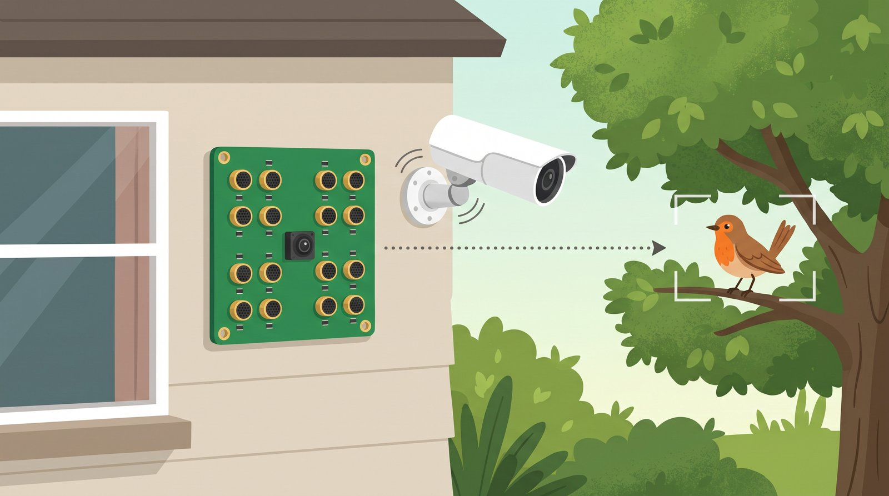
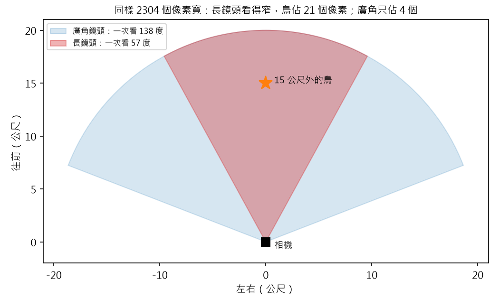
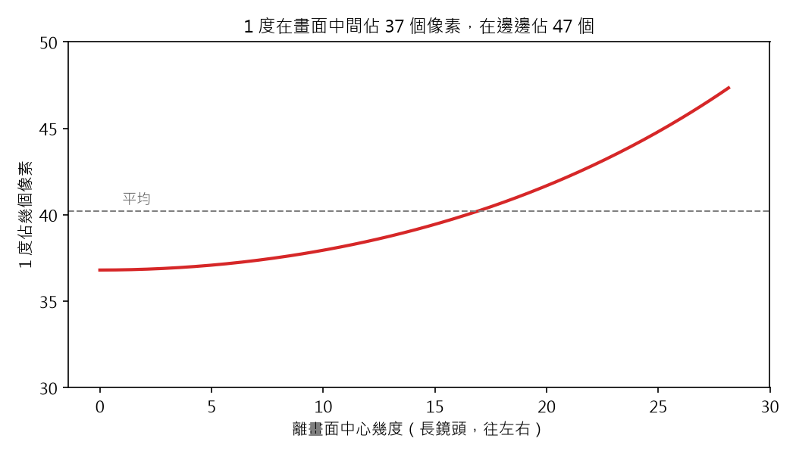
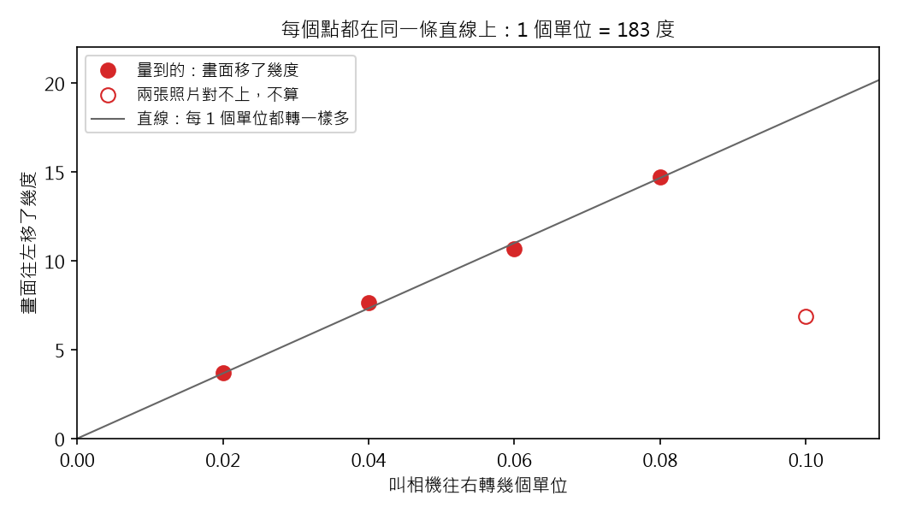
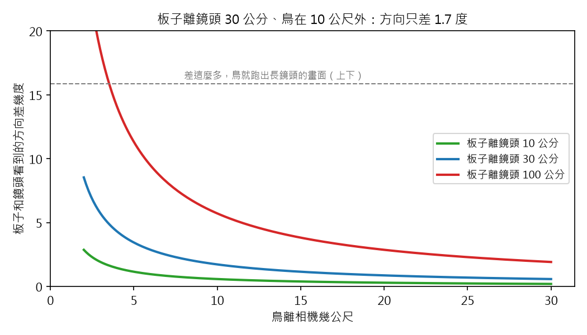

# 聲音相機 番外篇 4：麥克風說「右邊 20 度」，相機要轉多少、畫面要看哪裡？

> 草稿（Claude 起稿，Aaron 改寫後發布）。數字來自 `scripts/bonus4_angle_to_pixel.py`；
> 鏡頭的視角來自 TP-Link C545D 的規格表；齒輪鬆動的 2 度和上下的 44 度來自 2026-10-25 的轉動測試
> （`scripts/step3_ptz_calibrate.py`）。寫給 12 歲的讀者；「深入一點」可以跳過。

## 重點摘要：這篇會教你的 3 件事

1. **長鏡頭看得窄，所以同一隻鳥，在畫面上比較大。**
2. **方向可以換算成畫面上的位置。** 鏡頭像一個小洞，光直直穿過去，落在畫面上。
3. **相機轉了多少，可以從畫面移了多少量出來。**

麥克風板會告訴我：「鳥在右邊 20 度、上面 10 度」。可是相機聽不懂「度」。
它要知道：馬達要轉多少？轉過去以後，鳥會出現在畫面的哪裡？
麥克風板還在路上，可是相機已經裝好了，這一篇先把相機這一半弄懂。

## 1. 長鏡頭看得窄，鳥在畫面上比較大

把一張紙捲成長長的紙筒，從裡面看出去：看得到的範圍變小了，可是看到的東西，佔滿了整個洞口。
長鏡頭就像長紙筒，廣角鏡頭就像短紙筒。

我的相機有兩個鏡頭：一個不會動的廣角鏡頭，和一個會轉的長鏡頭。
兩個鏡頭的畫面，都是 2304 個像素寬（像素是畫面上的一個小格子）。

- **淺藍色：** 廣角鏡頭，一次看 138 度，幾乎整個院子。
- **紅色：** 長鏡頭，一次看 57 度，只看一小塊。
- **星星：** 15 公尺外、15 公分長的鳥，大約像一隻麻雀。

同一隻鳥，在廣角鏡頭裡只有 4.5 個像素寬，看不出是什麼鳥；在長鏡頭裡有 21 個像素寬，大了 4.7 倍。
**發現：長鏡頭看得窄，可是鳥比較大。** 所以要轉過去，才拍得到鳥。
這也是為什麼方向要先算準：長鏡頭只看一小塊，方向錯太多，鳥就不在畫面裡。

## 2. 方向可以換算成畫面上的位置

在紙箱上戳一個小洞，對著窗外，紙箱裡面的牆上，會出現窗外倒過來的景色。這叫針孔相機。
光從外面直直穿過小洞，落在牆上。方向越偏，落點就離中間越遠。相機的鏡頭也是這樣。

所以只要知道鏡頭的視角，就能把「幾度」換算成「第幾個像素」。
例如：鳥在長鏡頭的正中間往右 10 度，就在畫面中心往右 372 個像素（2304 個裡的第 1524 個）。

- **紅線：** 長鏡頭上，1 度佔幾個像素。越往畫面邊邊，1 度佔的像素越多。
- **虛線：** 平均 1 度佔 40 個像素。

為什麼邊邊比較多？傍晚的太陽斜斜照過來，影子會拉得很長。
光斜斜落在平平的畫面上，也會被拉長。方向越偏，拉得越長。

**發現：1 度在畫面中間佔 37 個像素，在邊邊佔 47 個。** 只用平均值換算，邊邊會差好幾個像素。

> **深入一點：** 針孔相機的公式：像素 = f × tan(角度)。長鏡頭的 f 是 2109 個像素，
> 從「2304 個像素寬看 57.3 度」算出來。程式是 `acam/camera.py` 的 `degrees_to_pixels()`。
> 廣角鏡頭看 138 度，邊邊被拉得更多，不完全像針孔相機，所以這篇只用它比大小。

## 3. 相機轉了多少，可以從畫面移了多少量出來

相機的馬達，聽的不是「度」，而是它自己的「單位」。規格表沒寫 1 個單位是幾度，所以我自己量。

方法像疊兩張描圖紙：轉之前拍一張，轉之後拍一張，把兩張疊起來，左右推，推到圖案對齊為止。
推了幾個像素，用第 2 節的方法換成度數，就知道相機轉了幾度。

- **實心紅點：** 叫相機往右轉 0.02、0.04、0.06、0.08 個單位，畫面各移了幾度。
- **空心紅點：** 轉 0.10 個單位那一次，兩張照片對不上，不算。那天是晚上，畫面暗、重疊的部分也太少。
- **灰線：** 一條直線就穿過所有實心點，最多只差 0.32 度。

**發現：每 1 個單位都轉一樣多，大約 183 度。** 所以 0.01 個單位，大約是 1.8 度。
鳥在右邊 20 度，就叫相機往右轉大約 0.11 個單位。

> **深入一點：** 疊描圖紙的方法叫「相位相關」（phase correlation），OpenCV 的
> `cv2.phaseCorrelate()`，會順便給一個「對得多好」的分數。分數低於 0.03 的那一次不算。
> 測試當天用相機回報的位置計算，得到 186 度；這篇用叫相機轉的單位計算，得到 183 度，差不到 2%。
> 上下也量了：1 個單位大約 44 度。

## 4. 齒輪有一點鬆，每次都從同一邊轉過去

腳踏車的鏈條鬆鬆的時候，踩下去的第一下，輪子不會馬上動，要先把鬆的那一段拉緊。
相機裡的齒輪也有一點鬆。往右轉之後再往左轉，最前面的一點點，只是在拉緊齒輪，鏡頭沒有動。

我第一次量的時候不知道這件事，每次量到的度數都不一樣。
後來改成：**每次都先往左退一點，再從左邊往右轉到目標**，齒輪一直是拉緊的，量到的度數才一致。

**發現：齒輪大約鬆 2 度。** 每次從同一邊轉過去，就不會差這 2 度。

## 5. 麥克風板和鏡頭裝得近，看到的方向就幾乎一樣

伸出一隻手指，先閉左眼看，再閉右眼看：手指好像跳了一下。兩隻眼睛的位置不一樣，看到的方向就不一樣。
手指越近，跳得越多；看遠處的山，幾乎不會跳。

麥克風板和鏡頭，也是兩隻「眼睛」。它們裝得越近、鳥越遠，看到的方向就越接近。

- **三條線：** 板子離鏡頭 10、30、100 公分時，兩邊看到的方向差幾度。
- **虛線：** 差到 15.8 度，鳥就跑出長鏡頭畫面的上下邊。

**發現：板子裝在鏡頭旁邊 30 公分內，方向只差 1 到 2 度。** 可是如果離 1 公尺、鳥只在 5 公尺外，
就會差 11.3 度。所以麥克風板要裝在相機旁邊。

## 6. 這一篇還做不到的事

- **兩邊的「正前方」還沒對齊。** 麥克風板說的 0 度，和相機的 0 度，不一定是同一個方向。
  板子到了以後，要放一支手機播鳥叫，量出兩邊差幾度。
- **麥克風板的方向不夠準。** 轉過去以後，鳥在畫面裡，但不一定在正中間。之後要讓相機在畫面裡再找一次鳥。

下一篇：麥克風板到了，讓攝影機聽到鳥叫，自己轉頭去看。

## 程式碼

- GitHub：https://github.com/HsinNan123/acoustic-camera
- 核心：`acam/camera.py`（`degrees_to_pixels()` 和 `pixels_to_degrees()`：度數和像素互相換算）
- 重現本文所有數字和圖：`python scripts/bonus4_angle_to_pixel.py`（要用測試那天存下的照片；照片拍到我家院子，沒有放上 GitHub）
