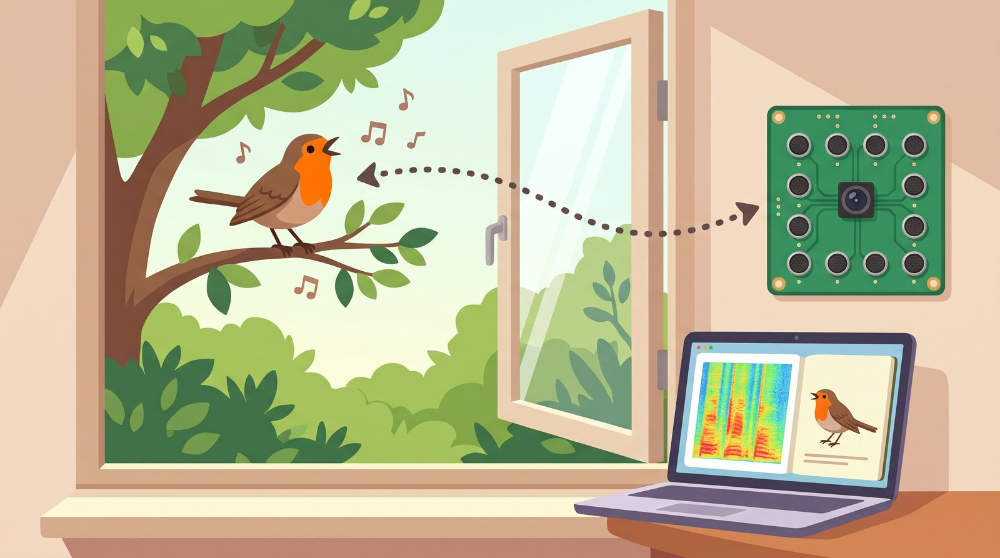
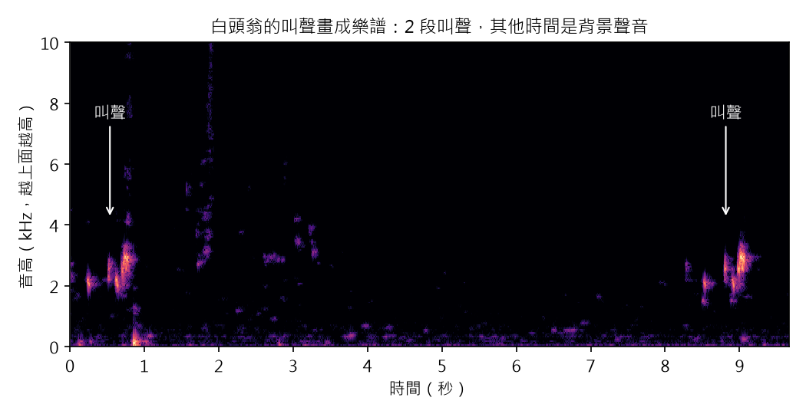
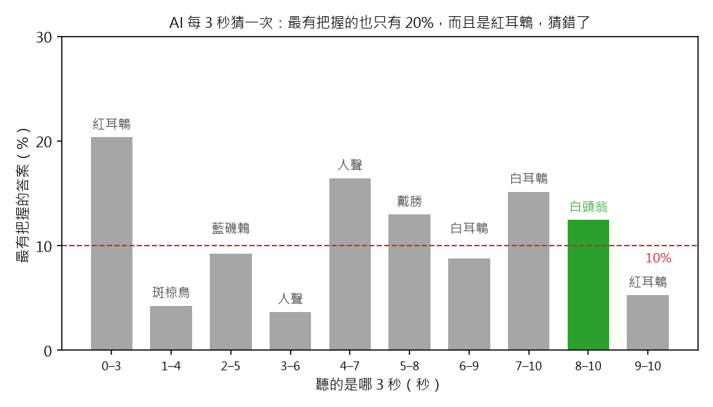
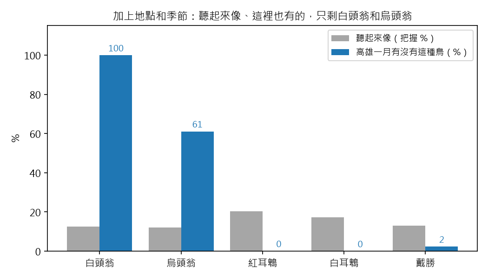
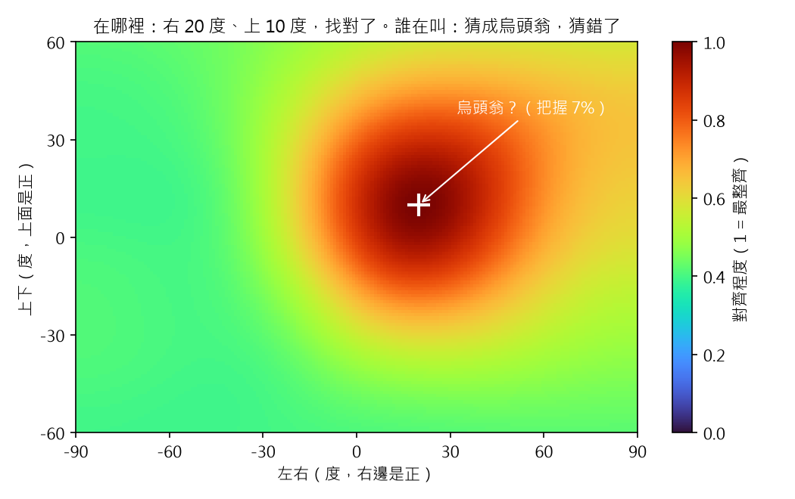

# 聲音相機 番外篇 5：AI 聽得出是哪一種鳥、在哪裡嗎？

> 草稿（Claude 起稿，Aaron 改寫後發布）。數字全部來自 `scripts/bonus5_birdnet.py`。
> 錄音是一段真的白頭翁叫聲（高雄，公眾領域）；AI 是免費的 BirdNET。寫給 12 歲的讀者；「深入一點」可以跳過。

## 重點摘要：這篇會教你的 3 件事

1. **AI 認鳥，是看聲音畫成的樂譜。** 它聽過幾千種鳥叫，像一本會聽的圖鑑。
2. **AI 的答案，要配上它有幾成把握、這裡有沒有這種鳥，一起看。** 只看第一名，常常會猜錯。
3. **找方向交給麥克風板，認鳥交給 AI。** 會指方向的 AI 還在研究，而且還沒學過鳥叫。

前面幾篇都在找「鳥在哪裡」。可是賞鳥的人更想知道：「那是什麼鳥？」
麥克風板還在寄來的路上，我先下載了一個免費的 AI：BirdNET，讓它聽一段真的白頭翁叫聲，看它認不認得出來。

## 1. AI 認鳥之前，先把聲音畫成一張圖

樂譜上，音越高，音符畫得越上面；時間往右走。聲音也可以這樣畫：
每一個時間、每一個音高，有聲音的地方就畫亮一點。這張圖叫做**聲譜圖**，這篇叫它「聲音的樂譜」。

- **亮的地方：** 這個時間、這個音高有聲音。越亮，聲音越大。
- **箭頭：** 白頭翁的 2 段叫聲，在 0.1 到 1.0 秒、8.4 到 9.3 秒，大約在 2 到 3 kHz。
- **其他時間：** 背景聲音。最下面一直有低低的聲音，還有幾條直直的亮線。

這段錄音是 The Nature Box 在高雄錄的，長 9.7 秒，作者把它放進公眾領域，誰都可以用。

> **深入一點：** 聲譜圖是把聲音切成很短的一小段（1024 張聲音照片），每一小段算出每個音高有多大聲，
> 再一段一段排起來。直直的亮線從低音一路到高音，很像東西碰到麥克風的聲音，這是推測。
> BirdNET 每次看 3 秒，只看 0 到 15 kHz。

## 2. AI 聽得出是鵯，分不出是哪一種鵯

你聽多了同學的聲音，不用回頭，就知道是誰在叫你。
BirdNET 也是這樣：它聽過非常多鳥叫的樂譜，記住每一種鳥長什麼樣子。它認得 6522 種聲音，大多是鳥，也有人聲。

它每聽 3 秒，就說出幾個答案，每個答案都附上**把握**：0 到 100%，越高，代表它越確定。
我讓它每 1 秒往後移一次，一共聽了 10 次：

- **每一根柱子：** 這 3 秒裡，AI 最有把握的答案，和它的把握。
- **綠色：** 猜對，是白頭翁。只有 8 到 10 秒這一次，把握 12%。
- **紅色虛線：** 10%。BirdNET 預設把握不到 10% 的答案就不顯示。

**發現：AI 最有把握的答案是紅耳鵯，只有 20%，猜錯了。**
可是有叫聲的那幾段，第一名全都是「鵯」這一家的鳥：紅耳鵯、白耳鵯、白頭翁。
AI 聽出是鵯，只是分不出哪一種。沒有叫聲的時候，它還是會猜，例如人聲、戴勝，所以把握低的答案不能相信。

> **深入一點：** 這裡用的是 BirdNET 2.4，每次 3 秒的框，每 1 秒移一次（重疊 2 秒）。
> 把握是模型最後一層經過 sigmoid 的分數，不是機率：每一種鳥分開打分數，加起來不一定是 100%。
> 這段錄音的叫聲很短，只佔 3 秒裡的一小部分，這也是把握低的原因之一。

## 3. 加上地點和季節，答案就少很多

在台灣的公園聽到鳥叫，你不會猜是企鵝。因為你知道，台灣的公園裡沒有企鵝。

BirdNET 還有第二個 AI：給它地點和第幾週，它就說出這裡、這個季節可能有哪些鳥。
我給它高雄、一月：6522 種裡，只剩 192 種可能出現。

- **灰色：** 第 2 節裡，把握超過 10% 的鳥，聽起來像的程度。
- **藍色：** 第二個 AI 說，高雄一月有這種鳥的程度。
- 紅耳鵯、白耳鵯聽起來最像，可是高雄一月幾乎沒有（0%），所以拿掉。

**發現：加上地點和季節，只剩白頭翁（12%）和烏頭翁（12%），白頭翁只高一點點。**
白頭翁和烏頭翁是近親，叫聲很像。烏頭翁是台灣特有種，第二個 AI 說高雄一月也可能有（61%），所以這兩種很難分。

> **深入一點：** 第二個 AI 是 BirdNET 的地點模型 2.4，輸入緯度 22.63、經度 120.30、第 3 週
> （BirdNET 一年分 48 週，一月中是第 3 週）。分數不到 3% 的鳥就拿掉，這是 BirdNET 預設的做法。
> 精確的數字：白頭翁 12.5% 對 烏頭翁 12.0%。

## 4. 會指方向的 AI，還沒學過鳥叫

老師點名的時候，聽到「有！」，一轉頭就知道是誰、坐在哪裡。
有一種 AI 也想這樣：一邊認出是什麼聲音，一邊指出聲音從哪裡來。

這種 AI 還在研究中。研究的人每年辦比賽（DCASE），大家用同一份錄音來比。
這份錄音有 13 種聲音：說話、拍手、電話、腳步聲、敲門……**沒有一種是鳥**。
所以現在拿來找鳥，它不認得鳥叫。

也有研究團隊做了「找鳥叫的方向，再把每隻鳥的聲音分開」的系統（HARKBird），可是我找不到可以下載的程式和授權。

**發現：會指方向的 AI 還不能拿來找鳥。** 所以我把工作分成兩半。

## 5. 分工：麥克風板找方向，AI 認鳥

兩個人一起賞鳥：一個人拿望遠鏡找鳥在哪裡，另一個人翻圖鑑查是什麼鳥。
我的聲音相機也這樣分工：**麥克風板用數學找方向，AI 認鳥。**

我把第 2 節裡 AI 認出白頭翁的那 3 秒，模擬成從右邊 20 度、上面 10 度傳到 Sipeed 板子，
每支麥克風再加上一點自己的雜訊。然後兩邊各做各的：

- **白色＋：** 鳥真正的位置，也是聲源定位地圖最紅的地方。
- **白色字：** AI 聽其中一支麥克風，猜的鳥名和把握。

**發現：方向找對了，鳥名卻換成烏頭翁，把握只有 7%。**
方向很穩：多一點點雜訊，紅點還是在原地。鳥名很容易變：白頭翁和烏頭翁本來就只差一點點，雜訊一來，答案就換了。

所以最後一步交給長鏡頭：轉過去拍下來，看頭頂。白頭翁頭頂後面是白的，烏頭翁頭頂是黑的，看一眼就分得出來。

> **深入一點：** 每支麥克風的雜訊比叫聲小 20 dB（雜訊小 100 倍），疊在錄音本來就有的背景聲音上。
> AI 只在高雄一月的 192 種裡選。方向用第二篇的聲源定位地圖，只聽 2 到 8 kHz。

## 6. 自己也可以玩的開源 AI

| 專案 | 可以做什麼 | 授權 |
|---|---|---|
| BirdNET-Go | 裝在樹莓派上，24 小時聽院子，網頁上看今天有哪些鳥 | CC BY-NC-SA 4.0 |
| BirdNET（這篇用的） | 用 Python 認一段錄音裡的鳥 | 程式 MIT；模型 CC BY-NC-SA 4.0 |
| OpenSoundscape | Python 工具箱：可以跑 BirdNET 和 Google 的 Perch，也能用好幾台錄音機找聲音的位置 | MIT |
| Perch 2.0（Google） | 認得 14597 種動物的聲音：鳥、青蛙、昆蟲、哺乳動物 | 程式 Apache 2.0；模型授權我還沒確認 |

**授權要注意：** BirdNET 的模型是 CC BY-NC-SA 4.0，只能**非商業**使用。
像我這樣的興趣專案可以用；如果要做成產品賣，就要另外找授權。

## 7. 這一篇還做不到的事

- **只聽了一段錄音。** 叫聲很短，還有背景聲音。要在自己的院子錄很多段，才知道 AI 到底準不準。
- **板子聽到的聲音是模擬的。** 等 Sipeed 板子到了，用真的 6 支麥克風再試一次。

下一篇：麥克風板到了，讓攝影機聽到鳥叫，自己轉頭去看。

## 資料來源

- 白頭翁叫聲：The Nature Box，"Pycnonotus sinensis call.ogg"，高雄，2024-01-18，CC0（公眾領域），
  https://commons.wikimedia.org/wiki/File:Pycnonotus_sinensis_call.ogg
- BirdNET 模型 2.4（聲音和地點）：Cornell Lab of Ornithology 和 Chemnitz University of Technology，
  CC BY-NC-SA 4.0，https://github.com/birdnet-team/BirdNET-Analyzer
- birdnet Python 套件 1.3.0：MIT，https://github.com/birdnet-team/birdnet
- BirdNET-Go：https://github.com/tphakala/birdnet-go
- OpenSoundscape：https://github.com/kitzeslab/opensoundscape
- Perch 2.0：van Merriënboer 等人 (2025). Perch 2.0: The Bittern Lesson for Bioacoustics. arXiv 2508.04665
- DCASE 比賽的錄音（STARSS23，13 種聲音）：https://zenodo.org/records/7709052
- HARKBird：Suzuki 等人 (2016). Interspeech 2016

## 程式碼

- GitHub：https://github.com/HsinNan123/acoustic-camera
- 核心：`acam/beamform.py`（聲源定位地圖）、`acam/sim.py`（模擬每支麥克風）
- 重現本文所有數字和圖：`python scripts/bonus5_birdnet.py`（要先 `pip install birdnet==1.3.0 ai-edge-litert`；
  第一次會下載錄音和 BirdNET 模型）
